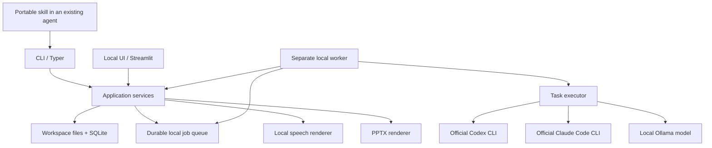

# Архитектура brofessor

Предлагаемое устройство, 01.11.2026. Команды, модули и форматы ниже ещё не реализованы.

## Одно ядро, равноправные интерфейсы

Streamlit и CLI непосредственно вызывают Python application services. UI не запускает shell-команды CLI для бизнес-операций. Ядро не импортирует Streamlit/Typer и не зависит от провайдерских SDK. Отдельный HTTP API для связи собственных интерфейсов в v1 не нужен.

Разница интерфейсов - в представлении: UI показывает цитаты, редактор сценария, аудиоплеер и превью слайдов. CLI выдаёт читаемый текст или стабильный JSON, пути к тем же артефактам и статусы.

## Предлагаемый стек

| Область | Выбор и основание |
|---|---|
| Core | Python 3.12, uv, Pydantic. Совместим с локальной обработкой документов и речи. Системный Python macOS не изменяется |
| CLI / UI | Typer / Streamlit как тонкие клиенты одной библиотеки |
| Состояние и поиск | SQLite, транзакции и FTS5. Нет отдельного сервера БД. Возможность FTS5 проверяет `doctor` |
| Импорт | pypdf для текстового PDF, EPUB importer в порядке spine, стандартные обработчики Markdown/TXT. Выбор EPUB-библиотеки после проверки лицензии |
| Текст | Официальные Codex/Claude CLI runners и прямой Ollama HTTP adapter |
| Речь | Кандидаты Qwen3-TTS и Chatterbox через стабильный MLX runtime. Выбор по измеренному RU/EN пилоту |
| Монтаж | FFmpeg/ffprobe, сегменты WAV и финальный MP3. Версии и параметры фиксируются |
| Презентации | Небольшой Node/PptxGenJS renderer. Проверяемый открытый способ рендеринга превью, например LibreOffice, выбирается в пилоте |
| Проверки | pytest, проверки типов/формата, Streamlit AppTest и браузерный smoke test. Настоящие модели отдельно от offline CI |

Это технические defaults, а не обязательная установка всех зависимостей для любой команды. Extras для UI, TTS и slides позволяют запускать core CLI без тяжёлых пакетов. Runtime, встроенный в Codex desktop, не является зависимостью проекта.

## Три разных способа исполнения

### 1. Задания из UI или обычного CLI

Worker выполняет фиксированный workflow и передаёт отдельные ограниченные задачи в `TaskExecutor`:

- `CodexRunner`: официальный `codex exec`, собственная сохранённая авторизация пользователя, вход через stdin/файл и структурированный финальный результат.
- `ClaudeCodeRunner`: официальный `claude -p`, собственная авторизация, JSON/schema output. Кандидат ограниченного запуска: `--safe-mode --tools ""`, после проверки сочетания флагов. Не использовать `--bare` для подписочного входа: этот режим не читает OAuth/Keychain.
- `OllamaExecutor`: генерация по `/api/chat` с JSON schema. Это вызов модели, а не передача ей управления shell.

Runner не должен сам импортировать книгу, управлять очередью или рендерить артефакты. Он решает конкретную смысловую задачу над предоставленным набором фрагментов. Необходимые данные выдаёт core. Для Claude отключаются ненужные инструменты, для Codex выбираются ограниченные permissions/sandbox. Точные флаги закрепляются после smoke test стабильной версии.

Процессы запускаются списком аргументов без shell-интерполяции. Им передаются deadline, лимит объёма и область доступа. Не используются публичные CI с подписочными credentials, собственный OAuth-посредник или извлечение токенов из файлов агента. При необходимости входа задача получает `needs_auth` с инструкцией штатного входа.

### 2. Работа внутри уже открытого Codex или Claude Code

Переносимый skill получает задачу и evidence через core CLI, использует текущего агента для рассуждения и передаёт типизированный результат обратно на проверку. Такой режим не запускает второй агентный цикл по умолчанию.

Предлагаемый обмен: `task prepare` → входной пакет с task ID и revision → результат агента → `task accept`. Тот же контракт данных используют автоматические исполнители, но протокол выполнения различается: host-agent возвращает результат позже, поэтому задача остаётся в `waiting_for_agent` без занятого worker. Не требуется изображать этот режим как синхронный вызов `generate()`. Результат устаревшей задачи отклоняется, повторная отправка не дублирует работу.

Один canonical skill хранится в `skills/brofessor/`. Установка создаёт поддерживаемое клиентом размещение/ссылку: `.agents/skills` для Codex и `.claude/skills` для Claude Code. Общий `SKILL.md` не зависит от расширений конкретного хоста. Эти навыки появятся на этапе реализации.

### 3. Полностью локальная работа

CLI или UI → worker → локальный Ollama → локальная TTS → локальные файлы. Здесь не требуется подписка агента. Профиль включает проверенную локальную модель, достаточный context budget и выключенные облачные функции Ollama. Одного адреса localhost недостаточно, если Ollama способен переслать запрос облачной модели.

## Контракты и ответственность

| Контракт | Содержимое и инвариант |
|---|---|
| `Source` / `SourceRevision` | ID, оригинальный файл, хеш, формат, происхождение, версия импортёра |
| `SourceUnit` / `Locator` | Страница PDF, глава/anchor EPUB или диапазон текста. Номера PDF и печатные номера различаются |
| `Coverage` | Обработанные, исключённые и проблемные единицы. Покрытие чтения и редакционный отбор хранятся отдельно |
| `EvidenceBundle` | Ограниченный набор оригинальных фрагментов с локаторами и revision, который получил исполнитель |
| `TaskRequest` / `TaskResult` | Тип операции, brief, evidence, JSON schema, настройки, provenance исполнителя, ошибки. Валидация до применения |
| `Answer` / `Draft` | Утверждения, ссылки, неопределённость, редакционные решения и пользовательские версии |
| `PodcastPlan` / `SlidePlan` | Структура результата, speaker IDs/языки, содержимое слайдов, ссылки на evidence. Не содержат команд shell |
| `SpeechBackend` | Текст сегмента, voice profile, язык и настройки → WAV, измеренная длительность и метаданные |
| `Artifact` | Формат, путь, хеш, входные версии, сценарий/план, инструмент рендеринга, результаты QA |
| `Job` / `Stage` | Состояние, checkpoint, ошибки, исполнитель, события, cancellation token и ссылки на результаты |

Валидная JSON schema и существующая цитата проверяют структуру. Достоверность и смысловое соответствие тезиса источнику проверяются отдельным шагом и на контрольном корпусе.

## Хранение и восстановление

Одно workspace содержит оригиналы, извлечённые фрагменты, редактируемые Markdown/JSON drafts, аудиосегменты и результаты. SQLite является источником состояния для идентификаторов, revisions, заданий и событий. FTS-индекс производный и перестраивается. Для переносимости предусмотрены backup/export базы и файлов с относительными путями и manifest версии схемы.

Оригиналы и готовые версии артефактов неизменяемы. Новая редакция создаёт revision. Файл записывается во временный путь, проверяется и атомарно переносится до публикации ссылки в транзакции БД. Незарегистрированный файл после сбоя можно выявить без выдачи его как результата.

В v1 один worker на workspace и одна тяжёлая модельная операция одновременно. Получение задания атомарно, есть защита от второго worker и heartbeat/lease. Состояния: `queued`, `running`, `waiting_for_agent`, `needs_auth`, `succeeded`, `failed`, `cancelled`, `interrupted`. Возобновление использует последний подтверждённый checkpoint, а не выдаёт незавершённый этап за успешный.

CLI и UI обращаются к общему локальному ProcessManager для запуска worker. После старта worker живёт независимо от родительского интерфейса. Он пишет прогресс в workspace. Streamlit периодически читает события, например через fragment. `session_state` хранит только выбранный экран, черновик формы и подобное временное состояние.

Идемпотентность защищает от повторного submit. Отмена останавливает принадлежащую заданию группу процессов, сохраняет завершённые сегменты и не трогает чужой сервер/процессы пользователя. При восстановлении PID сам по себе не считается доказательством живого worker. Истечение lease обрабатывается транзакционно.

Ключ переиспользования включает входные revisions, brief, prompts/schema version, выбранную модель/исполнителя, голос, язык, настройки и renderer/template version. Недоступную точную ревизию облачной модели отмечать как неизвестную, не обещать побитовую воспроизводимость.

## Работа с источниками и выводами

Обзор книги проходит по всем разделам с видимым покрытием. Для вопроса используется поиск по выбранному набору источников с расширением контекста. При вопросе на другом языке возможна генерация поисковых формулировок, но ссылки остаются на оригинал. Лексический поиск проверяется на пилоте. Локальные embeddings добавляются, если измеренный recall недостаточен, без обязательной внешней vector DB.

Сценарий и слайды используют одну доказательную базу, но разные редакционные планы. Подкаст строится из устойчиво пронумерованных реплик. Роль ведущего, голос и язык разделены. Для серии сохраняются карта тем, термины и распределение материала между выпусками.

Сначала рендерится короткий фрагмент, затем выпуск. Продолжительность определяется готовым аудио. Поправки длины меняют сценарий содержательно. Техническая нормализация громкости и пауз не заменяет редактуру.

## Матрица равноправия интерфейсов

Каждая операция v1 имеет общий service API. Синтаксис CLI здесь предварительный.

| Операция | CLI | Streamlit |
|---|---|---|
| Пространства | `workspace create/list/export/import` | Создание, выбор, перенос |
| Источники | `source add/list/show` | Загрузка, список, просмотр оригинального фрагмента |
| Покрытие | `source coverage` | Статусы разделов и ошибки |
| Поиск и вопросы | `search`, `ask` | Поиск, чат и переход к цитате |
| Заметки/редактура | `note`, `draft show/update` | Заметки и редактируемые drafts |
| Профили | `executor list/configure`, `doctor` | Выбор исполнителя, модель/голоса, диагностика |
| Выпуск материалов | `podcast create`, `slides create` | Формы с фокусом, языком и длительностью |
| Управление работой | `job list/show/cancel/resume` | Прогресс, события, отмена и продолжение |
| Артефакты | `artifact list/export` | Аудиоплеер, превью, загрузка файла |

CLI дополнительно поддерживает `--json`, `--wait` и машинные коды ошибок. UI представляет те же возможности визуально. Для редакционных полей одинаковы validation и revision conflict handling.

## UI первой версии

Три рабочих области: источники, обсуждение, результаты. Пользователь выбирает workspace и источники, видит проблемы импорта, задаёт вопросы, задаёт параметры подкаста/слайдов и наблюдает задания. Результаты доступны для прослушивания/просмотра и скачивания. Настройки исполнителя открываются по необходимости.

Сервер слушает loopback по умолчанию. Это локальный single-user продукт, без облачного деплоя и встроенных аккаунтов. Загруженный файл сохраняется в управляемый путь workspace, имя от браузера не используется как доверенный путь. Размер/формат проверяются до обработки.

Сильный компромисс Streamlit: быстро получить рабочее исследовательское пространство, но сложное редактирование графов, drag-and-drop canvas и многопользовательский SaaS потребуют другой оболочки. Общий service API позволяет заменить оболочку без переделки обработки источников.
