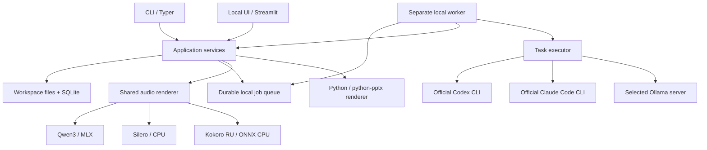

# Архитектура brofessor

Архитектура и структура кода актуализированы 07.11.2026. Фактический прогресс указан в плане реализации.

## Одно ядро, равноправные интерфейсы

Streamlit и CLI непосредственно вызывают Python application services. UI не запускает shell-команды CLI для бизнес-операций. Ядро не импортирует Streamlit/Typer и не зависит от провайдерских SDK. Отдельный HTTP API для связи собственных интерфейсов в v1 не нужен.

Разница интерфейсов — в представлении: UI показывает рабочую область проекта со связанными результатами, читаемый текст, структурные поля редактирования, цитаты, аудиоплеер и скачивание PPTX. JSON доступен в дополнительном редакторе. `interfaces/web/components/content.py` отвечает только за представление и буфер полей; сохранение, проверки ссылок и постановка заданий остаются в общих services. CLI выдаёт читаемый текст или стабильный JSON, пути к тем же артефактам и статусы. PDF/PNG-превью используются отдельно для QA и пока не входят в UI.

Группы результатов выводятся из существующих связей render → draft, episode → series и follow-up → parent. Новых сущностей и статусов в БД нет. Ввод в редакторах результатов и заметок имеет локальную копию восстановления с номером исходной редакции. Применённые виджетами изменения записываются в папку `recovery/` проекта. Если закрыть страницу во время ввода, браузер удерживает активное поле в своём локальном хранилище до его восстановления. В истории появляется только явно сохранённая версия. UI блокирует сборку при несохранённом или устаревшем буфере. Сервис фиксирует `revision` при постановке задания, включая случаи конкурентной правки через другой клиент.

При создании задания общий сервис проверяет параметры его вида. Количество слайдов входит только в `slides`, длительность — в подкаст и серию, число выпусков — в серию. При сопоставлении идентичных запросов от старых клиентов учитываются прежние форматы входа. Уже сохранённые строки заданий и checkpoints остаются доступными.

`preview_turn` фиксирует редакцию, номер реплики и голосовые входы по тем же правилам, что и полный подкаст. Worker передаёт нужную реплику существующему рендереру с общим проектным `audio-segments/`. У пробы отдельное задание и артефакт, она не попадает в список версий готового выпуска.

## Предлагаемый стек

| Область | Выбор и основание |
|---|---|
| Core | Python 3.12, uv, Pydantic. Агентная навигация - Pydantic AI Slim 2.66.0. Совместим с локальной обработкой документов и речи. Системный Python macOS не изменяется |
| CLI / UI | Typer / Streamlit как тонкие клиенты одной библиотеки |
| Состояние и поиск | SQLite и транзакции для состояния; BM25 по исходным фрагментам в Python для поиска. Отдельного сервера БД нет; `doctor` проверяет текстового исполнителя |
| Импорт | pypdf для текстового PDF, стандартные ZIP/XML для EPUB в порядке spine, обработчики Markdown/TXT |
| Текст | Официальные Codex/Claude CLI runners; готовый `OllamaModel` Pydantic AI 2.66.0 для локального или выбранного Ollama-сервера |
| Речь | Qwen3-TTS CustomVoice через MLX, Silero CIS Base / RU и Kokoro RU на CPU, F5 на Metal. Каталог задаёт движок, языки, голоса, настройки и источник весов. Общий аудиорендер отвечает за сегменты и монтаж; `infrastructure/speech/engines.py` — за загрузку и синтез конкретных движков. Kokoro RU использует закреплённые ONNX, RUAccent и acute-aware espeak data; исходный сценарий сохраняется, подготовленный текст записывается в метаданные сегмента |
| Монтаж | FFmpeg, сегменты WAV, MP3 и M4B с главами. Версии и параметры фиксируются |
| Презентации | `python-pptx>=1.0.2,<2` и Pillow внутри Python-сервиса. Измерение текста установленным шрифтом, native-объекты и заметки докладчика. Офисный пакет нужен только для отдельной визуальной QA, а не для генерации |
| Проверки | pytest, проверки типов/формата, Streamlit AppTest и браузерный smoke test. Настоящие модели отдельно от offline CI |

Это технические defaults, а не обязательная установка всех зависимостей для любой команды. Extras `ui` и `speech` позволяют запускать core CLI без интерфейса и моделей речи. Генератор PPTX входит в базовые Python-зависимости, отдельный runtime или framework ему не нужен. Runtime, встроенный в Codex desktop, не является зависимостью проекта.

## Структура пакета

Код устанавливается из `src/brofessor`. Каталоги отражают существующие обязанности приложения:

| Каталог | Что в нём находится |
|---|---|
| `interfaces/cli/` | `app.py` собирает Typer-команды; группы разделены на проекты, источники, задания, черновики, заметки, речь, серии, задачи, модели, книги и обучение. `common.py` содержит вывод, параметры подключения и ограниченное ожидание worker |
| `interfaces/web/` | `app.py` настраивает Streamlit и выбирает экран; `pages/` содержит задачи, новую задачу, источники, заметки, проекты и поиск; `dialogs/` — настройки, импорт и подтверждения; `components/` — общие редакторы, навигацию, прогресс и управление результатами; `assets/` — JS |
| `application/` | Общие `service`, `pipeline`, `worker`, задачи, проекты, прогресс, начальная озвучка и обслуживание моделей. Оба интерфейса используют эти операции |
| `features/` | Предметная обработка: `sources/` — коллекции, чтение и навигация по оригиналам; `books/` — перевод, терминология и аудиокниги; `podcasts/` — сценарии, серии и сверка; вопросы, отчёты и обучение — отдельные модули |
| `infrastructure/` | `storage/` — SQLite, настройки и OS-locks; `text/` — bounded runners и guardian; `agents/` — адаптер навигации Pydantic AI; `speech/` — движки, каталог и референсы; `formats/` — импорт, EPUB/PDF/PPTX и монтаж аудио |
| `models.py` | Общие Pydantic-контракты; типы конкретных форматов остаются рядом с их реализацией |
| `contracts/` | Общие `JobKind`/`JobStatus`, независимые состояния этапов и первой озвучки, провайдер, роли/языки/доказательность и TypedDict записей. Только стандартная библиотека; без зависимости от application, хранилища, интерфейсов или SDK |
| `prompts/` | Читаемые Markdown-инструкции, оглавление, простой загрузчик и синтетический предпросмотр; тексты закрепляются во входах текстового задания |

`WebContext` создаётся заново при rerun и явно передаёт экрану проект, переводчик, каталог проектов и callbacks навигации. Он не хранит задания и не заменяет application services. Ключи `session_state`, восстановление редакторов и история проекта сохранены.

Закрытые предметные значения описаны `StrEnum` с прежними явно заданными строками. У отдельных возможностей и адаптеров свои типы: виды отчётов, оценки ответов, режимы чтения, операции и состояния навигации, синтаксис и состояния ссылок коллекций, происхождение терминов и настроек модели, движки речи, форматы/расширения. Они не объединяются по одному совпадающему написанию. Общие группы состояний и видов неизменяемы; имена файлов и browser/session keys определяются у владельца.

SQLite и опубликованные JSON сохраняют обычные строки и прежнюю структуру. TypedDict описывает межмодульные записи, не подменяя runtime-валидацию и поддержку исторических неизвестных значений. Общие Pydantic-поля используют именованные `Literal`-алиасы из членов enum, когда прямое enum-поле меняет JSON schema и ключ checkpoint. Ограниченная конфигурация mypy проверяет общие контракты и выбранные аннотированные границы.

`interfaces/web/state_keys.py` собирает прежние динамические ключи и преобразует enum в обычные скалярные значения для Streamlit widgets. Иначе сохранённое состояние и варианты выбора могут иметь разные Python-типы после rerun. Числовые диапазоны и обычные IDs передаются напрямую; рекурсивного преобразования произвольных структур нет. Browser storage keys и trigger name закрытого поля передаются JS через существующий `data`; формат сохранённых браузерных данных не изменён.

Публичная команда остаётся `brofessor`; её entry point — `brofessor.interfaces.cli.app:app`. Streamlit получает установленный `interfaces/web/app.py`. Фоновые процессы запускаются как `python -m brofessor.application.worker` и `python -m brofessor.infrastructure.text._runner_guardian`. Каталог речи, JS и шрифты читаются через `importlib.resources`, поэтому запуск не зависит от текущего каталога.

Тесты следуют тем же обязанностям в `tests/application`, `tests/features`, `tests/infrastructure` и `tests/interfaces`. Общие синтетические исходники и fake-модели находятся в `tests/helpers`; тестовые модули не импортируют друг друга. Fixtures и их provenance остаются в `tests/fixtures`. Рабочие пробы находятся в `tools/` и запускаются из корня как `python -m tools.<module>`.

Перенос каталогов меняет внутренние Python-пути без совместимых модулей-переадресаций. Команды пользователя, схема SQLite, расположение проектов, job kinds, snapshots и редакции сохраняются. Последующее выделение промптов описано ниже; старые checkpoint keys поддерживаются отдельно.

## Читаемые и закреплённые промпты

Все авторские инструкции находятся в `src/brofessor/prompts`: отдельный UTF-8 `.md` для операции или общей части и [оглавление](../src/brofessor/prompts/README.md) с назначением, переменными, схемой, связями и версиями workflow. Вынесены общие правила runner, агента, подсказки повторной навигации и инструкции developer-проб. Тексты и сборка сохранены при выделении. Схемы, сериализация evidence, бюджеты, проверки цитат и расчёт длины остаются в прежних Python-модулях. Референсные транскрипты и текст озвучки остаются входными данными речевого адаптера.

Загрузчик использует стандартные `importlib.resources`, `re`, `json` и `contextvars`; шаблонизатора или prompt framework нет. Именованные `{{variables}}` подставляются один раз; содержимое источника не разбирается повторно. Неизвестный ID, отсутствующий файл, неизвестная или незаполненная переменная дают ошибку до соответствующего inference. Набор нового задания проверяется при создании. Граница runner входит в общий лимит входного сообщения.

Новые текстовые задания получают `prompt_snapshot` в существующих `params`: тексты применимого семейства, индивидуальные SHA-256 и общий хеш. Это frozen inputs без новой таблицы. Каждый запуск pipeline устанавливает свой контекст; он переносится в asyncio и `to_thread`, включая Ollama и навигационный агент. Правка файла применяется к новому заданию и регенерации; явный повтор с тем же request key и resume удерживают прежний набор. Новые checkpoints хешируют фактические сообщения с runner-инструкциями: один stdin-текст для Codex/Claude, `system` и `user` для Ollama.

Задания без snapshot используют неизменяемый `prompts/legacy.json` с точными исходными шаблонами, включая старые ветки чтения и диалога. Для них сохраняется прежний алгоритм checkpoint keys. Принятые результаты не регенерируются из-за переноса, пользовательские правки остаются старшей сохранённой редакцией. Архив проверяется по хешу и синтетическому историческому эталону. Его не обновляют при редактуре действующих `.md`.

`brofessor prompts list|show|preview` работает без модели и проекта; `preview --all` показывает синтетическую сборку каждого варианта и фактическое размещение runner-границы. `--variables FILE` подставляет заданные данные. `-w PATH ... --job ID` выбирает закреплённые инструкции сохранённого запуска; примерные входы остаются синтетическими, а прошлые материалы не проигрываются. Команда показывает реальный путь шаблонов editable checkout или установленного wheel. UI и CLI создают задания через те же сервисы закрепления, отдельного механизма промптов у интерфейсов нет.

## Исполнители

### Задания из UI или CLI

Worker выполняет фиксированный workflow и передаёт отдельные ограниченные задачи в `TaskExecutor`:

- `CodexRunner`: официальный `codex exec --json`, собственная сохранённая авторизация пользователя, вход через stdin/файл и структурированный финальный результат из `-o`. JSONL stdout остаётся ограниченным транспортом CLI, нового событийного runtime нет. Strict schema явно содержит `properties` и для пустого объекта.
- `ClaudeCodeRunner`: официальный `claude -p`, собственная авторизация, JSON/schema output. Ограниченный запуск использует `--safe-mode --tools ""`, отключённые slash commands и MCP, без сохранения сессии. Настоящий подписочный сценарий проверен на Claude Code 2.1.185 в M4. Не использовать `--bare` для подписочного входа: этот режим не читает OAuth/Keychain.
- Ollama: `OllamaModel` / `OllamaProvider` через `pydantic_ai.direct.model_request_stream`, native JSON schema и `/v1/chat/completions` выбранного сервера. SDK разбирает поток и собирает результат; отдельного агентного цикла для одного inference нет.

Подписочная проверка Claude разбирает штатный `auth status --json`: код 1
означает корректный статус без входа и даёт инструкцию `claude auth login`.
Для входа через Anthropic допускаются `oauth_token`, `claude.ai` и прежний
`claude_ai` при `loggedIn=true` и `apiProvider=firstParty`. API-ключи и другой
провайдер отвергаются до передачи материалов. Авторизация Desktop не подменяет
статус терминального CLI; Desktop не предоставляет `--print`/`--output-format`
для фонового runner. [Диагностика и проверка](experiments/claude-authentication.md).

Runner не импортирует книгу, не управляет очередью и не рендерит артефакты. Он решает конкретную смысловую задачу над предоставленным набором фрагментов. Необходимые данные выдаёт core. Для Claude отключены инструменты, для Codex выбран read-only sandbox с отключёнными shell/web и пользовательскими правилами. Реальные проверки стабильных CLI и точные ограничения записаны в [приёмке M4](experiments/v1-acceptance.md).

Процессы запускаются списком аргументов без shell-интерполяции. Им передаются deadline, лимит объёма и область доступа. Не используются публичные CI с подписочными credentials, собственный OAuth-посредник или извлечение токенов из файлов агента. При необходимости входа задача получает `needs_auth` с инструкцией штатного входа.

### Текст через Ollama

CLI или UI → worker → Ollama на выбранном IP:порту → TTS и файлы на компьютере приложения. По умолчанию адрес 127.0.0.1:11434, поэтому весь путь может работать локально. При выборе другого компьютера исходный текст обрабатывается на нём. Сервер должен сообщать отключённые облачные функции и установленную модель; cloud aliases и remote model metadata отвергаются до передачи источников. Redirects и HTTP proxies не используются. Проверенный локальный профиль остаётся доступен без подписки агента.

Адрес фиксируется в задании и участвует в checkpoint identity. Старые задания с `ollama_port` сохраняют loopback и прежние checkpoint keys; новые задания используют `ollama_address`.

С 07.11.2026 инференс использует официальный extra `pydantic-ai-slim[openai]==2.66.0`, без собственного NDJSON-парсера. OpenAI SDK служит клиентом OpenAI-compatible протокола Ollama; base URL и фиктивный ключ заданы явно, окружение не выбирает облачный endpoint или credentials. HTTPX2 отключает proxies и redirects. `max_retries=0` исключает скрытые обращения, автоматическая инструментальная телеметрия отключена. Проверки `/api/status`, `/api/tags` и `/api/show`, блокировка весов, общий deadline и отмена остаются в приложении; ограниченный HTTP-поток останавливает чтение до накопления ответа сверх 8 MiB. SDK обязан получить явный `finish_reason`, приложение принимает только `stop` и текст без tool calls. Модели с объявленной поддержкой `think=false` получают документированный эквивалент `reasoning_effort="none"`; остальные сохраняют default.

Преобразование JSON-схемы SDK отключено для этого транспорта: native endpoint получает прежнюю схему с titles, defaults и ограничениями. System/user сообщения собираются из прежнего закреплённого набора промптов. Frozen inputs, идентичность checkpoints, проверки модели/цитат/языка, пользовательские редакции и публикация остаются в прежнем pipeline. Подписочные Codex/Claude adapters не меняются.

## Контракты и ответственность

| Контракт | Содержимое и инвариант |
|---|---|
| `Source` / `SourceRevision` | ID, оригинальный файл, хеш, формат, происхождение, версия импортёра |
| `SourceUnit` / `Locator` | Страница PDF, глава/anchor EPUB или диапазон текста. Номера PDF и печатные номера различаются |
| `Coverage` | Обработанные, исключённые и проблемные единицы. Покрытие чтения и редакционный отбор хранятся отдельно |
| `EvidenceBundle` | Ограниченный набор оригинальных фрагментов с локаторами и revision, который получил исполнитель |
| `TaskRequest` / `TaskResult` | Тип операции, brief, evidence, JSON schema, настройки, provenance исполнителя, ошибки. Валидация до применения |
| `Answer` / `Draft` | Утверждения, ссылки, неопределённость, редакционные решения и пользовательские версии |
| `PodcastPlan` / `SlidePlan` | Структура результата, speaker IDs/языки, содержимое слайдов, ссылки на evidence. Не содержат команд shell |
| `SpeechBackend` | Текст сегмента, voice profile, язык и настройки → WAV, измеренная длительность и метаданные |
| `Artifact` | Формат, путь, хеш, входные версии, сценарий/план, инструмент рендеринга, результаты QA |
| `Job` / `Stage` | Состояние, checkpoint, ошибки, исполнитель, события, cancellation token и ссылки на результаты |

Валидная JSON schema и существующая цитата проверяют структуру. Достоверность и смысловое соответствие тезиса источнику проверяются отдельным шагом и на контрольном корпусе.

## Хранение и восстановление

Проект объединяет набор источников и связанные ответы, черновики, подкасты и презентации. В коде одному проекту соответствует один `workspace`. UI/CLI создают и выбирают именованные проекты, позволяют выбрать внешнюю папку и подключить существующий workspace. Новые проекты по умолчанию находятся в пользовательском каталоге данных вне приложения. Источники и результаты остаются внутри выбранного проекта; список проектов и последний выбор относятся к пользовательским настройкам приложения. Изменения настроек защищены коротким OS-lock и атомарной записью файла.

Одно workspace содержит оригиналы, извлечённые фрагменты, редактируемые Markdown/JSON drafts, аудиосегменты и результаты. SQLite является источником состояния для идентификаторов, revisions, заданий и событий. FTS-индекс производный и перестраивается. Для переносимости используются относительные пути и версия схемы. Корректно закрытый workspace можно скопировать целиком. Отдельного формата экспорта и импорта в v1 нет.

Схема 2 добавляет таблицу `notes`: append-only редакции с ID, данными `Note` (заголовок, текст, source IDs), необязательным origin `{job_id, revision}` и временем. Открытие схемы 0/1 добавляет таблицу и меняет `user_version`, сохраняя существующие записи; схема 2 уже не открывается старым приложением, знающим только 1. Нового хранилища или ORM нет. Заметки записываются синхронно в короткой SQLite-транзакции, без очереди и модели. `save_note` проверяет title/text и source IDs, а expected revision защищает от потери параллельных правок. Копирование ответа использует ID, производный от job/revision: повтор возвращает актуальную заметку, не заменяя авторскую редактуру. Origin сохраняется при редактировании; source IDs заметки не превращают её текст в первичное свидетельство. Оба интерфейса используют общие сервисы, а все редакции остаются в SQLite при переносе workspace.

Оригиналы и готовые версии артефактов неизменяемы. Новая редакция создаёт revision. Файл записывается во временный путь, проверяется и атомарно переносится до публикации ссылки в транзакции БД. Незарегистрированный файл после сбоя можно выявить без выдачи его как результата.

В v1 один worker на workspace и одна тяжёлая модельная операция одновременно. Получение задания атомарно. Один OS-lock удерживается весь срок жизни worker, второй процесс не начинает работу. Состояния: `queued`, `running`, `succeeded`, `failed`, `cancelled`, `interrupted`. Ошибка авторизации сохраняется как понятная причина неуспеха. Возобновление использует последний подтверждённый checkpoint, а не выдаёт незавершённый этап за успешный.

CLI и UI обращаются к общему локальному ProcessManager для запуска worker. После старта worker живёт независимо от родительского интерфейса. Он пишет прогресс в workspace. Streamlit периодически читает события, например через fragment. `session_state` хранит только выбранный экран, черновик формы и подобное временное состояние.

Идемпотентность защищает от повторного submit. Отмена останавливает принадлежащую заданию группу процессов, сохраняет завершённые сегменты и не трогает чужой сервер/процессы пользователя. При восстановлении PID сам по себе не считается доказательством живого worker. Получив OS-lock после аварии, новый worker переводит оставшиеся `running` задания в `interrupted`. Повторное выполнение запускается явно.

Для render общий сервис сначала фиксирует редакцию, модель, настройки и образцы голосов, затем получает автоматический ключ из тех же входов. CLI и UI не вычисляют его отдельно и повторно используют одно задание. Описательные поля каталога не меняют ключ. Явный `request_key` сохраняет первый принятый снимок, в том числе при одновременной отправке из двух клиентов; несовместимое назначение ключа отклоняется. Новая явная строка ключа позволяет создать отдельное задание с теми же входами.

Ключ переиспользования включает входные revisions, brief, prompts/schema version, выбранную модель/исполнителя, голос, язык, настройки и renderer/template version. Недоступную точную ревизию облачной модели отмечать как неизвестную, не обещать побитовую воспроизводимость.

## Работа с источниками и выводами

Обзор книги для медиа проходит по всем разделам с видимым покрытием. `ask` использует оригинальные фрагменты: до 24 тысяч символов сериализованных evidence — напрямую, для больших наборов — отбор в `features/questions.py`. Выбранный текстовый исполнитель пишет до четырёх RU/EN вариантов запроса. Существующий локальный BM25 ищет каждый вариант и сам вопрос; reciprocal-rank fusion с постоянной 60 объединяет результаты, оставляя восемь начальных совпадений. Для каждого совпадения сначала берутся оно само, два следующих и один предыдущий читаемый фрагмент того же источника, затем следующий результат. Контекст ограничен 90 тысячами символов вместе с IDs, именами и локаторами, без обрезки фрагментов. Это существующая верхняя граница итогового контекста чтения; больший объём выбран после реального пропуска продолжений сцен. Отдельной модели embeddings, индекса или сервиса нет.

`SearchQueries` и `Answer` проходят обычные checkpoint/cancellation/validation механизмы pipeline. Неподходящий для бюджета фрагмент не подменяется обрезанной выдержкой. Для `retrieved` карта содержит запросы, начальные совпадения и число выбранных фрагментов; остальные имеют `not_selected`, а не `read`. Выбранные фрагменты считаются прочитанными только после принятия ответа. UI и CLI явно показывают ограниченность поиска. При отсутствии совпадений возвращается `insufficient_evidence` без случайной подстановки источника и без дополнительного вызова модели ответа. Полнота отобранного контекста не гарантируется; текущих замеров достаточно, чтобы пока сохранить BM25.

`Answer` поддерживает `supported`, `insufficient_evidence`, `conflicting_evidence` и список `{citation, text}`. Все новые cited IDs должны иметь цитату из выбранного оригинала. `features.questions.validate_answer` разрешает лишь различия пробелов/переносов и восстанавливает исходную подстроку; изменения слов, чисел и пунктуации отклоняются до checkpoint и публикации. Для противоречия нужны минимум две разные цитаты, в том числе допускаются две позиции в одном фрагменте. Семантическое соответствие цитат выводу проверяется отдельно. Старые ответы без quotes сохраняют совместимость и явную отметку в UI. `application.service.answer_evidence` разрешает сохранённую редакцию в цитаты, имена файлов, локаторы и полные фрагменты для обоих интерфейсов; `draft show` добавляет это в envelope, оставляя `data` редактируемым контрактом. `application.service.search` задаёт общий scope/limit обычного локального поиска в CLI/UI, без модельных вызовов.

`application.service.follow_up` создаёт обычное `ask` job с унаследованными источниками, провайдером, настройкой модели, портом Ollama и языком (последний можно изменить). В params сохраняется плоский список `conversation` из закреплённых job/revision, а не ссылка на «последний ответ». Предыдущие ссылки берутся из уже сохранённого родителя; максимум шесть пар и 12 тысяч сериализованных символов. При превышении снимаются самые ранние пары с явным `conversation_omitted`; слишком большой единственный родитель вызывает ошибку без обрезки. Все старые jobs/drafts остаются в истории. `features.questions.history` проверяет ревизии и одинаковый source scope; `application.service.question_context` возвращает ровно тот контекст, который используют UI/CLI и pipeline.

Поисковое расширение видит контекст для разрешения местоимений. Итоговый prompt отдельно помечает прошлые ответы как редакционный контекст, который может быть ошибочным; ответы и их цитаты устанавливаются заново по оригиналам. Заметки автоматически в этот путь не включаются. Нового типа model job, агентного цикла или отдельного chat-хранилища нет. UI не разрешает сохранить ответ в заметку или уточнить его при несохранённых/устаревших правках; повторный submit одного текста для той же редакции идемпотентен. CLI явно отвергает provider/source flags у `--reply-to`, чтобы не игнорировать выбранные пользователем ограничения.

Текущее полное чтение реализовано в `features/sources/reading.py`: короткий набор передаётся целиком, длинный — пакетами до 24 тысяч символов сериализованных фрагментов. Исполнитель возвращает ровно одну ограниченную заметку на каждый ID пакета; полнота и уникальность проверяются до checkpoint. Для итогового контекста до 90 тысяч символов слишком большие заметки дополнительно объединяются ограниченными группами с исходными ID. Текст не обрезается, но смысловая компрессия может терять детали. При отсутствии уменьшения задача завершается явной ошибкой, а не зацикливается.

`coverage.json` атомарно обновляется после принятого пакета. В нём остаются прочитанные, ожидающие и исключённые фрагменты с локаторами; короткие источники отмечаются прочитанными только после принятия итогового ответа. Общий `application.service.coverage` добавляет ссылки из сохранённой редакции, а для render — из закреплённой редакции. CLI `job coverage` и таблица Streamlit используют один отчёт. Старые отчёты с `read`/`excluded` разворачиваются по существующим исходным единицам без миграции БД.

Сценарий и слайды используют одну доказательную базу, но разные редакционные планы. Подкаст строится из устойчиво пронумерованных реплик. Роль ведущего, голос и язык разделены. Для серии сохраняются карта тем, термины и распределение материала между выпусками.

`models.Slides` — общий контракт исполнителей, редактора CLI/UI и рендера: у каждого слайда заголовок, до шести пунктов, notes и исходные IDs; дополнительно одна таблица (1–6 столбцов, 1–8 строк) либо 2–5 шагов. Рядом с таблицей/схемой допускаются до двух коротких пунктов. Старые drafts без необязательных полей проходят ту же валидацию. Prompt предлагает подходящий вид по содержимому и переносит пояснения в notes; отдельного LLM/layout framework нет.

`infrastructure.formats.slides.render(plan, output, source_labels=...)` скрывает выбор native-компоновки и запись PPTX. Модуль не зависит от TTS, workspace, текстового провайдера или frontend. Существующий `infrastructure.formats.audio.render_slides` делегирует ему вызов; pipeline разрешает source IDs в имена файлов и оригинальные локаторы. Pillow измеряет обычный/жирный Arial, Liberation Sans или DejaVu Sans; выбранное семейство записывается в PPTX. Горизонтальная последовательность при длинных подписях становится вертикальной. Шрифты ограничены снизу: 28 pt заголовок, 20 pt пункты, 18 pt таблица/шаги. Межстрочный интервал задан явно. Если текст не помещается, возвращается ошибка с номером слайда; исходный план и предыдущий файл остаются целыми. Рендер не обрезает слова и не добавляет слайды за пользователя. Notes сохраняют исходный текст, все IDs и доступные подписи источников; на слайде остаётся короткий указатель. Запись атомарна. Шрифты не встроены: просмотр на машине с другим набором шрифтов требует проверки.

Обычная сборка сразу озвучивает весь выпуск. При точечном исправлении можно сначала прослушать одну реплику. Продолжительность определяется готовым аудио. Поправки длины меняют сценарий содержательно. Техническая нормализация громкости и пауз не заменяет редактуру.

Для выпуска от 20 минут `features/podcasts/writer.py` строит один outline с отдельными задачами частей и исходными ссылками; это план одного выпуска, не механизм серии. Для нового выпуска при постановке фиксируется ориентир `target_words`: 115 слов/мин для RU и 150 для EN на выбранных голосах Qwen Base. Объём направлен на середину допустимого интервала длительности — например, 21 минуту при запросе 20 и 57 минут при запросе 60. Это оценка для написания текста. Фактическую длительность определяет аудио. Сохранённые задания без этого поля продолжают работу со старыми ориентирами (125 и 100 соответственно) и прежними checkpoints. План выпуска делится на части примерно по пять минут. Счётчик проверяет объём каждой части с допуском 15%; при нехватке/избытке текста или отсутствии одного ведущего допускается одна содержательная правка. Непринятая правка не попадает в checkpoint; продолжение повторяет только её. Готовые длинные реплики делятся по предложениям/словам до 300 символов RU или 400 EN с сохранением слов, ведущего и ссылок. Короткие previews сохраняют прежние prompts/checkpoints.

На первом отсутствующем сегменте Qwen берёт общий пользовательский `qwen-speech.lock` до загрузки весов. Второй проект ожидает с возможностью отмены. Сборка полностью готовых сегментов и CPU-движки проходят независимо. Дескриптор освобождается при завершении или аварии процесса. Эта сериализация ограничивает конкуренцию собственных Qwen-задач. Доступная память также зависит от других приложений.

Обычный метод новых подкастов фиксирует `dialogue_version=3`. В этой версии следующий раздел получает остаток общего бюджета слов, поделённый на оставшееся число частей. Последний раздел также проверяется по суммарному бюджету с допуском 2%. Одна ограниченная содержательная правка сохраняется. Инструкции согласуют мужской голос ведущего и женский голос собеседницы с грамматическим родом их собственных реплик. Версии 1/2 сохраняют прежние prompts и принятые checkpoints. Эти правила обычного метода внутренние; экспериментальный метод выбирается отдельно при создании.

Обычные задания подкастов, серий и слайдов фиксируют `reading_version=2`. При сжатии большого набора заметок каждый сохранённый факт остаётся в отдельной заметке с одним исходным ID. Общий пересказ с нераспределённым перечнем ссылок больше не используется: на английском контрольном выпуске такой пересказ позволил сценаристу приписать верные события неверным фрагментам. Сжатие ограничивается существующими бюджетами чтения и итогового контекста; отсутствие уменьшения останавливает задание. Старые задания без версии сохраняют прежние схемы, prompts и checkpoints. Эта структура сохраняет связь факта со ссылкой, но не доказывает семантическую точность ответа модели.

Явный `writing_method=originals` для длинного подкаста или серии выбирает `reading_version=3`; эпизоды получают `dialogue_version=4`. `features/sources/reading.py` сохраняет имена/локаторы в metadata заметок. `features/podcasts/episode_writer.py` использует цель слушателя, отношения между источниками, неравные веса частей и достаточность материала. Раздел получает original packet по ID из плана с ограниченным соседним контекстом, полный редакционный план и cumulative handoff до 6000 символов. Состояние не является evidence и не входит в публичную схему Podcast. Проверка citations ограничена реальным packet, язык проверяется и для подкласса Podcast. Пропущенное дополнительное соседство явно записывается; обязательные оригиналы не обрезаются. В correction сохраняются также все ID первого ответа, а пакет пересчитывается по фактическому размеру ответа. Старые версии prompts/checkpoints не меняются, чтение прежних series notes не переписывает родительские файлы. По [контрольному сравнению](experiments/episode-writing.md) новый метод остаётся экспериментальным.

`features/podcasts/checks.py` исполняет отдельный `check_podcast` через существующий worker. `application.service.check_script` закрепляет сохранённую редакцию, source IDs, язык и текущую модель задачи; проверки не создают отдельные недавние задачи. Пакеты содержат до 12 полных реплик и укладываются в 60 тысяч символов вместе с оригиналами. Отчёт различает supported/issue/needs_context и отдельно перечисляет pending/unchecked. Findings указывают точную подстроку реплики; дословность source excerpts проверяется общим валидатором вопросов до checkpoint. Принятые пакеты и частичный отчёт сохраняются; resume не меняет revision/model и не переписывает черновик. Scope — cited originals и соседи, без обещания полного поиска опровержений. UI/CLI показывают один отчёт; нет обязательного допуска к TTS и автоматической правки.

После озвучки общий расчёт возвращает фактическую длительность, отклонение от цели, число слов, наблюдаемый темп и ориентир для редактуры. Для полного выпуска требуется одновременно допуск 10% и диапазон 20–60 минут. CLI получает данные в metadata аудиоартефакта, UI показывает длительность и подсказку при расхождении. Переход к другой TTS не меняет этот контракт. Автоматического растягивания/обрезания аудио и цикла бесконечных модельных исправлений нет.

В UI загрузку Qwen с голосами предлагает карточка подкаста. CLI запускает ту же операцию через `tts download`. Установленные веса хранятся в общем пользовательском кеше отдельно от приложения и проектов; задание сохраняет выбранную модель и её ревизию. Скачивание использует существующую очередь выбранного проекта и независимый worker; прогресс, отмена и продолжение доступны как для остальных заданий. Hugging Face Hub переиспользует завершённые файлы. Полные старые снимки импортируются в общий каталог через hardlink или копирование. Наличие всех файлов закреплённого размера проверяется до статуса «установлена»; генерация использует установленную модель без сетевого скачивания.

Дефолтный профиль — `qwen3-base`, Qwen3-TTS Base 1.7B 4-bit с готовыми ExNihilus. Пакет голосов является зависимостью скачивания и содержит отдельные пары для RU и EN. При постановке рендера `preset_snapshot` разрешает нужные WAV и расшифровки, после чего существующий `freeze` копирует их в проект. Голосовой пакет исключается из зависимостей сохранённого рендера, поскольку для инференса используются проектные копии. Ключ каждого аудиосегмента включает хеш и текст его образца. Base вызывает штатный ICL, а длинные реплики делит по границам предложений и слов. CustomVoice остаётся отдельным адаптером для сохранённых заданий и явного выбора модели.

После KISS-аудита публичный список содержит только `qwen3-base`. Восемь прежних профилей помечены `legacy`. `get`, скачивание и явный рендер по точному старому ID используются для воспроизведения, а `use` выбирает только поддерживаемые профили. Старое или неизвестное значение настройки разрешается в Base. Метка legacy исключена из идентичности рендера.

`download_model` сохраняет полный снимок выбранной модели до запуска worker: источник весов, ревизию и манифест файлов. Изменение каталога при продолжении не подменяет загрузку. Установленные спецификации сохраняются в общем пользовательском кеше и разрешаются по прежним ссылкам. Старые download jobs без снимка используют прежний формат; восстановить историческую ревизию только по ID невозможно. Аудиозадания также сохраняют снимок с голосами и настройками. Прежние Qwen jobs с `repo@revision` остаются читаемыми, включая установленную ревизию, удалённую из текущего каталога.

Silero скачивается с официального сервера в отдельный каталог общих файлов; версия закреплена SHA-256, размером и обязательной проверкой перед загрузкой модели. Прерывание сохраняет `.part`; HTTP Range продолжает загрузку, а сервер без Range начинает её заново. OS-lock на файл предотвращает одновременную запись из разных проектов. Это тот же тип задания и существующая очередь. Для Silero нужен отдельный extra `silero`, MLX не требуется.

Silero CIS Base подключена только для русского; ударения задаются знаком `+` в редактируемом черновике. Цифры, латинские названия и неподдержанные символы требуется записывать словами: иначе модель удаляет их при своей обработке текста. Сервис отвергает такой запрос до постановки аудиозадания, рендер повторно проверяет вход. Язык исторического задания проверяет сервис рендера. Qwen сохраняет поддержку RU/EN.

Worker явно отвергает неизвестные виды задания; неизвестный generation/render больше не попадает в ветку подкаста. Новому сценарию достаточно добавить собственные schema/обработчик и представления в CLI/UI. Универсального workflow engine нет.

F5-TTS v1 (английский), F5-TTS Russian v2 и ESpeech RL-V2 (русский) используют один адаптер `f5` и закреплённый общий Vocos. Каталог содержит config, checkpoint/vocab и манифест зависимости; выбор и скачивание остаются обычными заданиями. Общий кеш не дублирует Vocos. `infrastructure/speech/references.py` сохраняет PCM16 WAV и точную расшифровку по языку и роли. Для старых F5-настроек сохранена скрытая CLI-команда `tts voice`. При submit образцы копируются в `voice-samples/` проекта, а относительные пути, SHA-256 и тексты фиксируются в model spec задания. Поэтому перенос закрытого проекта сохраняет входы озвучки. Ключ сегмента учитывает только образец конкретного ведущего и его расшифровку: изменение host не пересоздаёт guest.

F5 запускается на Metal через официальный стабильный пакет, Vocos читается только из установленного локального каталога. Передача точного текста образца исключает обращение к ASR; автоматический RUAccent не подключён. Инференс последовательно обрабатывает ограниченные фрагменты с проверкой отмены между ними. Отдельных UI/API/оркестраторов для нового движка нет. Зависимости F5 вынесены в extra `f5`; совместимый Hub 1.33 закреплён в lock вместо 2.4 из-за ограничения официальной зависимости `cached-path`. Совместимость скачивания и прежних workflow проверяется отдельно.

Серия реализована отдельным контрактом `features.podcasts.series.Series` и обычным заданием `podcast_series`: карта тем, распределение ID тем по выпускам и общий словарь с исходными ссылками. Каждая тема должна относиться ровно к одному выпуску. Проверяются уникальность ID, заголовков и терминов, разрешимость ссылок и запрошенное число выпусков. Это структурная проверка карты, а не доказательство смысловой полноты или отсутствия перефразированных повторов.

`series_episode` создаёт обычное задание `podcast`, закрепляющее ID серии, редакцию её плана и номер выпуска. Исполнитель, модель, источники и длительность наследуются из серии. Номер редакции входит в ключ идемпотентности. Ручная правка плана сохраняется обычной версией draft и влияет только на новые запросы. Вся серия не запускается автоматически: пользователь проверяет план и запрашивает нужные выпуски из CLI или UI.

После принятия плана сохраняется ограниченный `series-evidence.json` с результатом `features.sources.reading.prepare`. Эпизоды используют его и копию карты покрытия родителя с явной отметкой о переиспользовании. Пропажа заметок вызывает ошибку, а не незаметное перечитывание книги. Это файлы одного workspace без общего кеша между несвязанными заданиями и без нового состояния очереди. Контекст выпуска содержит назначенные темы, общий словарь и границы остальных выпусков. Рендер, сегментный кеш, отмена и восстановление остаются общими.

## Границы CLI и UI

Оба интерфейса вызывают общие application services для проектов, источников, генерации, редакций и управления заданиями. Правила валидации, фиксации входов и конфликтов редакций находятся в core. UI показывает только параметры выбранного результата; нерелевантные поля не меняют идентичность повторной отправки.

Текущие команды и примеры находятся в [README](../README.md#use-the-cli) и `brofessor --help`. Архитектура не дублирует справочник команд. Матрица проверок и фактические результаты находятся в [приёмке M4](experiments/v1-acceptance.md).

Новые аудиозадания принимают только модели из каталога или ранее сохранённые pinned specifications и фиксируют спецификацию при submit. Веса скачиваются явным download job; CLI может поставить render после уже ожидающего download. Старый resolver `repo@revision`/папки остаётся только на пути исполнения сохранённых jobs без спецификации. Публичного обхода каталога для новых заданий нет.

## UI первой версии

В проекте три раздела: задачи, источники и заметки. Глобальная левая панель содержит основную кнопку «Все проекты», проекты-папки и недавние задачи; поиск и настройки — значки рядом с brofessor. «Новая задача» находится в заголовке выбранного проекта. «Задачи» всегда открывает полный каталог вместо выбранной карточки; дополнительного «Все задачи» в карточке и дубля в папке нет. Выбор проекта и задачи хранится в сессии браузера; изменение общих preferences из другого клиента не переключает открытый контекст.

Каталог — отдельный `st.fragment` с нативным `st.text_input(live="0ms")`: каждый ввод меняет только поиск/список, не перезапуская остальную страницу. [Контракт live](https://docs.streamlit.io/develop/api-reference/widgets/st.text_input). Общий `application.tasks.list_tasks(query=..., kind=...)` читает заголовки последних редакций одним SQL-запросом без полных сценариев и сопоставляет префиксы слов с названием/исходной темой. Несколько слов запроса должны найтись в пределах одной primary-задачи; связанные запуски сохраняют одну строку, `match_id` позволяет открыть подходящего ребёнка. `child_id` по-прежнему выбирает последнего ребёнка для прежней навигации/MRU. CLI предоставляет тот же отбор через `task list --query --kind`. Поиск не вызывает модель и не меняет MRU. Смена запроса/фильтра сбрасывает страницу результатов. Строки используют нейтральное оформление, тип корневой задачи и дату создания; успешный render не подменяет тип на «Аудио · Готово».

Папки раскрываются нативными keyed `st.expander` без отслеживания состояния в Python; несколько папок могут оставаться открытыми при переходах. Название и значок папки открывают проект, отдельная стрелка слева раскрывает задачи; обе области имеют одну высоту, а выбранный фон охватывает всю строку. Кнопки задач находятся под ней. Путь показывается под заголовком проекта, настройки — одной кнопкой справа от brofessor. Небольшой Components v2-разделитель изменяет только CSS-долю высоты проектов/недавних, поддерживает pointer и клавиатуру, сохраняет долю в browser localStorage и не вызывает rerun. Оба списка имеют независимую прокрутку. Минимальная версия Streamlit для устойчивых keyed expanders — 1.64; lock сохраняет 1.66.1.

Удаление обратимо и общее для CLI/UI. `application.tasks.delete` в одной SQLite-транзакции вычисляет root всей связанной задачи, проверяет отсутствие queued/running операций и добавляет tombstone в `deleted_tasks` (schema 5). Каталоги, поиск и недавние скрывают весь root; `application.tasks.restore` снимает tombstone. Jobs, оригиналы, drafts, artifacts, notes и recovery остаются прежними. Submit связанных запусков и resume проверяют tombstone в той же транзакции, поэтому старый клиент не запускает скрытую задачу до восстановления. Миграция 0–4 сериализована `BEGIN IMMEDIATE`. `application.projects.delete` убирает регистрацию и MRU из preferences, сохраняет имя/путь для восстановления и не удаляет папку. Проект с активной работой не убирается. UI подтверждает действие в диалоге; CLI предлагает подтверждение или `--yes`. Это не очистка диска.

Название проекта и навигация собраны в одном верхнем блоке. Общий `interfaces/web/components/layout.py` содержит прежние стили навигации и единые роли заголовков H1–H4, подписей полей и метаданных для всех страниц и диалогов. Native wrappers заголовков нормализованы в main/dialog, прежние исправления sidebar сохранены. Цвет наследуется от темы, включая вынесенные Streamlit за `.stApp` диалоги. Основной текст и его межстрочный интервал сохранены. В карточке задачи готовый файл с выбором версии предшествует отдельному сценарию/плану; завершённый ход и модели находятся после материала. Активный или требующий внимания процесс остаётся перед результатом. Регенерация находится в «Операциях задачи», редакции и состояние редактора используют прежние services/session buffers. [Первая проверка плотности](experiments/ui-spacing.md), [единая иерархия и проверка всех экранов](experiments/ui-hierarchy.md).

`application/tasks.py` группирует прежние primary jobs по существующим связям обсуждения, серии, рендера и новому `regeneration`. Технические ID/kinds/история сохранены. Ограниченный MRU в preferences хранит только workspace path, root и последний primary child; содержимое и названия разрешаются из проекта. Чтение и опрос прогресса не меняют порядок. Отсутствующая папка не создаёт пустой Workspace; ошибочный child разрешается в root. Ошибка записи MRU не отменяет сохранённую задачу.

07.11.2026 структурная часть UI завершена отдельной [приёмкой](experiments/ui-structure.md). `interfaces.web.components.layout.section` задаёт нативное сворачивание, крупную роль и границу раздела; небольшой presentation-only компонент добавляет summary семантику H3 без второго видимого названия. Начальное раскрытие фиксируется в UI-сессии, режим редактирования открывает свой disclosure. Готовый файл, материал, предметные источники/проверки и служебный низ — отдельные области. JSON размещён в служебной области через прежний канонический буфер и recovery. История получает явный job_id отдельно от widget key, включая переводы; её селекторы не меняют текущую редакцию. Первый автоматический EPUB/PDF остаётся вариантом файла при появлении отдельных render jobs. Статусы незавершённых проверок выведены перед результатом. В настройках ограниченно прокручивается содержимое, действия Save/Cancel находятся отдельно. Это представление поверх прежних сервисов; новых правил core, таблиц и заданий нет.

Настройки — нативный `st.dialog` с разделами General, Models и Storage; он работает без проекта. Save валидирует все поля перед одной атомарной записью preferences; Cancel/Esc/закрытие сбрасывают staged значения. Язык интерфейса независим от языка содержимого. Явные загрузки и очистки не входят в staged транзакцию. Параметры форм разделены по workspace, редактор и recovery сохраняются при навигации и переводе подписей.

Модели по умолчанию копируются при создании. Схема 3 добавляет таблицу `task_models` с CAS revision; миграция 0/1/2 сохраняет jobs, sources, notes, drafts и artifacts. Изменяемые модели задачи отделены от замороженных job.params. Новые уточнения и выпуски копируют текущие настройки родителя; уже созданные дети и resume сохраняют прежние параметры. Перегенерация создаёт связанный primary job с указанием исходной редакции, сохраняя пользовательскую историю; проектные defaults отдельным уровнем не вводятся.

`application/maintenance.py` использует тот же Workspace и worker в служебной папке app data, создаваемой по запросу загрузки. Эта папка не регистрируется как пользовательский проект и не попадает в MRU. Исторические project download jobs остаются видимыми. Локальные модели речи удаляются только из управляемого кеша с учётом HF shared blobs и зависимостей; partial cleanup удаляет только части загрузок. Очистка аудио затрагивает только `audio-segments`. Model SH-lock охватывает загрузки, Qwen inference и Ollama generation, EX-lock — удаление; проектный audio SH-lock действует до завершения WAV/MP3 packaging, включая полностью кешированный render. Очистка отказывает при занятости и сохраняет lock inode. Дополнительные legacy guards учитывают старые активные workers. Ollama list/pull/delete работают через выбранный IP:port с прежней проверкой отключённых cloud features; загруженная в сервер модель не выгружается принудительно.

Для нового выпуска применяется Qwen Base с готовыми голосами. В проекте выбирают модель, а при отсутствии её файлов переходят в настройки. Запуск, отмена и продолжение скачивания доступны только в настройках; CLI `models` вызывает те же сервисы. Models показывает фактическое наличие файлов выбранного профиля, Storage — остальные профили и очистку. Текущие задания с прогрессом видны во всех разделах Settings, вне сворачиваемой истории. Завершённое задание в истории означает завершение попытки, а не наличие файлов после их последующего удаления. После установки из проекта запускается сборка сохранённой версии.

Раздел «История скачиваний» поясняет это различие и показывает дату запуска, профиль и исход каждой попытки в таблице. История не очищается при удалении весов и не используется как перечень установленных моделей.

`application.maintenance.latest_jobs` выбирает одну текущую попытку по закреплённому профилю либо паре Ollama server/model; активная попытка имеет приоритет над поздней ошибкой. Короткий OS-lock сериализует submit/resume между клиентами. Повторный запрос незавершённой загрузки продолжает прежний job с теми же params; после успешной попытки можно явно начать новую, например после удаления весов. Пути канонизируются, включая `/var` и `/private/var` на macOS. Наблюдение проверяет lifetime worker lock: оставшийся без worker `running` показывается как `interrupted`, не изменяя SQLite. Явный resume под полученным worker lock вызывает обычный recover и ставит тот же job в очередь; живой worker и его операции не затрагиваются. Исторические загрузки в проектах продолжаются в исходном workspace. Отдельных leases, очередей и протокола нет.

Передача использует прежний закреплённый Hugging Face cache, URL Range и Ollama pull. Законченные файлы и части сохраняются; при поддержке Range докачивается хвост, при HTTP 200 на Range перезапускается только этот файл. Для URL начальный прогресс учитывает существующий `.part`, Hub обновляет его после определения смещения. Контроль целостности и спецификация сохраняются. Периодический fragment перечитывает состояние из SQLite; закрытие диалога и UI не ограничивает жизнь worker. [Официальное описание кеша Hub](https://huggingface.co/docs/huggingface_hub/guides/manage-cache) и [fragment reruns](https://docs.streamlit.io/develop/api-reference/execution-flow/st.fragment) согласуются с этим разделением.

Сервер слушает loopback по умолчанию. Это локальный single-user продукт, без облачного деплоя и встроенных аккаунтов. Загруженный файл сохраняется в управляемый путь workspace, имя от браузера не используется как доверенный путь. Размер/формат проверяются до обработки.

Язык интерфейса хранится отдельно от материалов в пользовательском `brofessor/preferences.json`: под `XDG_CONFIG_HOME`, на macOS — в `~/Library/Application Support`, иначе — в `~/.config`. Save в Settings сохраняет RU/EN атомарно; язык результата и данные workspace от него не зависят. При первом запуске без сохранённого выбора учитывается язык браузера. `session_state` хранит текущие поля и редактор; устойчивые ключи виджетов сохраняют их при переводе подписей.

Streamlit обслуживает локальный пользовательский сценарий. Отдельный API-сервер и будущие оболочки сейчас не проектируются.

## Перевод EPUB и терминология — P1

`infrastructure/formats/epub.py` читает сохранённый оригинальный ZIP с прежними ограничениями безопасности импортёра, отдельно выделяет текст из XHTML и метаданных и сохраняет внутренние XML-позиции вместе с SHA-256 оригинала. Код, формулы и ресурсы остаются в снимке. Модель получает блоки с защищёнными inline-маркерами; ответ должен покрывать все переданные ID ровно один раз, сохранять маркеры, непустые spans и числовые значения. Локальная атомарная сборка меняет принятый текст, язык и необходимые метаданные новой книги. Теги, ссылки, CSS и иллюстрации не генерируются моделью. Неподдержанный класс EPUB отвергается явно. [Первоначальное сравнение подходов](experiments/epub-translation.md).

`features/books/terminology.py` различает значение термина, его выбранный перевод и точные исходные употребления. Ограниченное извлечение возвращает цитаты, поверхности и номер совпадения; core разрешает диапазоны и запрещает пересечения. Пользовательские значения сохраняются, а подходящие принятые значения передаются следующему пакету. Перевод дополнительно возвращает anchors фраз для каждого употребления. Коррекция изменяет только эти диапазоны: модель подбирает контекстную форму, остальной текст остаётся прежним. Редактор перебазирует неизменённые anchors; фразы с ручным вмешательством удерживаются и сообщаются отдельно. Проверка связей и цитат не доказывает правильности выделенного значения.

`features/books/translation.py` предоставляет общие операции для CLI и `interfaces/web/components/translation.py`. Новые `translate_epub`/`render_epub` исполняет прежний worker. SQLite schema остаётся 3: используются существующие jobs, drafts, artifacts и task_models. При submit фиксируются оригинал/hash, язык, glossary seed, версия workflow и текстовое подключение. Точное чтение/перевод идёт ограниченными пакетами через стандартные checkpoints pipeline. После сбоя завершённая сохранённая редакция переиспользуется даже при прерванной сборке файла; рендер выполняется локально из выбранной редакции. Неопубликованный файл после отмены не считается артефактом.

Изменение значения создаёт связанный запуск с `regeneration` и закреплённой родительской редакцией, не заменяя старую. Полная перегенерация также сохраняет историю и переиспользует прежний словарь/употребления. Workflow 2 добавляет сохранение исходного написания при обсуждении самих слов; старые jobs версии 1 сохраняют прежние prompts/checkpoints. UI использует общий редактор с recovery/CAS и показывает скачивание EPUB, словарь, исходные цитаты и удержанные ручные фразы. [Проверки терминологии](experiments/book-terminology.md).

Поддержка EPUB 2/NCX и стандартных XHTML DOCTYPE находится в том же ядре. `infrastructure/formats/epub_xml.py` разрешает только известные объявления без чтения внешних DTD и переносит изменённый текст/атрибуты в исходный DOM: namespace scopes, исходные префиксы и QName-значения метаданных сохраняются. В NCX переводятся подписи и согласуется dtb:uid, ссылки/иерархия остаются исходными. Проекция 2 разделяет вёрстку с ` ` по абзацам и исключает маркированные copyright/license notices с отчётом в артефакте/UI. Новая `epub_projection=3` дополнительно защищает текстовые вызовы square/cube и их корней. Jobs без параметра используют блоки проекции 1; render/regenerate/correction сохраняют выбранную проекцию. Workflow 3 передаёт полный релевантный словарь даже для пропущенных извлечением употреблений; старые prompts/checkpoints 1/2 сохраняются. Последний доступный экспорт выбранной редакции разрешается общим сервисом для CLI/UI; пересборка возможна при существующем файле. [Проверки совместимости, целой книги и читалки](experiments/epub-reader-compatibility.md). Новых библиотек, SDK, очереди или постоянного сервера нет. Реализация PDF описана в следующем разделе.

Новые задания и regenerate используют workflow 4 при прежней проекции. После извлечения или переиспользования словаря `review_recurring` находит до 32 частых неучтённых слов/фраз и передаёт модели ограниченные контексты их начала/середины/конца. Модель добавляет только проверяемые значения/употребления; прежние решения и занятые spans неизменяемы. Все фактические prompts ограничены 40 тысячами символов, стадия `glossary_review` использует прежние checkpoints. Частотное совпадение само по себе не назначает значение.

В workflow 4 неверные привязки можно один раз уточнить через отдельный `AlignmentBatch`, содержащий только IDs/targets. Полнота текста, inline-маркеры и числа проверяются до такого вызова. Переведённая формулировка и корректные блоки неизменяемы; после слияния все links проверяются ещё раз. Невалидный ответ не публикует draft/артефакт. Принятый checkpoint отдельного уточнения также переиспользуется; версии 1/2/3 сохраняют прежние prompts и поведение без уточнения.

Общий числовой валидатор учитывает дроби без ведущего нуля (`.34`), десятичную запятую и знак; потеря величины или завершающего значащего нуля отвергается. Независимая QA-утилита сверяет числовые величины и ASCII-функции уже в собранном XHTML, не по маркерам модели. `TextBlock.plain_text()` раскрывает защищённый оригинальный код/математику для цитаты в UI без изменения сериализованных блоков. Открытие недавней задачи из CLI-проекта использует общий `application.projects.open_project`; download готового файла не вызывает rerun. [Реальный полный контроль, fault/resume и ограничения](experiments/epub-recurring-terms.md).

## Перевод текстового PDF — P1

`infrastructure.formats.pdf.PdfBook` предоставляет тому же `book_translation` текстовые блоки, язык, SHA-256 и локальный renderer. `translate_pdf`/`render_pdf` используют прежние worker, SQLite schema 3, drafts, task models, checkpoints, отмену/продолжение и редактор CLI/UI. Новые задания фиксируют источник и `pdf_projection=2`; прежняя проекция 1 сохранена для старых заданий. Render закрепляет сохранённую редакцию. Модель получает текст/терминологию, не координаты сборки или команды.

pypdfium2 5.14.0 / PDFium 156.0.8076.0 извлекает текстовые объекты. `infrastructure/formats/pdf_layout.py` группирует projection 2 по базовым линиям, сохраняет inline-начертания/цвет/код и надстрочные сноски, декодирует известные PUA по собственным таблицам шрифта. `infrastructure/formats/pdf_background.py` через pypdf заменяет только выбранные текстовые строки числовыми TJ-перемещениями курсора, в том числе внутри уникальных Forms; исходные encodings и нетронутый текст не перегенерируются. Projection 1 сохраняет прежнее удаление объектов PDFium. Изображения и paths остаются исходными. Области ограничены соседним текстом, колонками, ячейками и иллюстрациями; сначала текст помещается в собственное место, затем допускается ограниченное локальное смещение. Строка оглавления, её номер и при наличии link rectangle перемещаются вместе. Неизменная команда под подписью схемы может следовать за переводом; карта сохраняет обе области.

ReportLab 5.1.0 создаёт текстовый слой с четырьмя встроенными начертаниями DejaVu Sans 2.37. Pyphen 0.18.1 дополняет переносы в узких областях; явные мягкие переносы добавляются только в неумещающиеся русские слова, чтобы сохранить пробелы на границах шрифтов. Внутри центрированных узлов слова остаются целыми, размер/центрирование учитывают внутреннее место фигуры. Проверяется фактическая ширина каждой строки. Переполнение, наложение, недостающий glyph или неподдержанная структура вызывают отказ. Исходный файл и прежний результат защищены; публикация атомарна после проверки отмены. Библиотеки закреплены в lock, fonts и лицензии входят в wheel; Codex runtime не нужен приложению.

Из-за ограничения потоков PDFium все его операции в модуле защищены одним процессным `RLock`; фоновые jobs по-прежнему исполняет отдельный OS-locked worker. Нового сервиса разметки или очереди нет. Проверенный класс — горизонтальный текст с простыми шрифтами и уникальными Forms с единичной матрицей на обычных страницах. Image-only, encryption/forms, rotation/crop, shared/transformed text Forms, Type0, clipped/invisible text и недекодируемые области отклоняются явно до модели. Переполнение перевода проверяется после его получения, до публикации файла. Формулы/код распознаются консервативно и перечисляются как сохранённые; raster labels не переводятся.

Экспорт сохраняет PDF и `layout-rN.json` с исходными/итоговыми областями, страницами, размерами шрифта и версиями renderer. UI показывает исходную цитату со страницей/координатами, терминологию, сохранённые объекты и файл выбранной редакции. `TextBlock.plain_text(text)` раскрывает защищённые фрагменты и в переведённом preview. Независимый QA читает фактический PDF, включая пробелы/переносы/числа, не ограничиваясь JSON-ответом. После [одной синтетической страницы](experiments/pdf-translation.md) проверена [целая реальная книга](experiments/pdf-whole-book.md): 31 страница, 262 блока, 352 сохранённые области, реальная сборка без модели и просмотр PDFium/Poppler. Произвольная inline-математика и иные классы PDF этим не приняты.

## Каталоги документов и Obsidian — P1.1

`features.sources.collections.connect` регистрирует канонический путь и ID `dir-*` без обхода документов. CLI `source add` и форма Sources используют то же ядро. SQLite schema 4 добавляет `collections` и `infrastructure.formats.ingestion.hidden`; миграция 0–3 сохраняет данные и сериализует обновление через `BEGIN IMMEDIATE`. Прочитанные при навигации оригиналы хранятся в общем content-addressed store, но не становятся автоматически источниками будущих задач. Явный импорт тех же байтов делает источник видимым.

`application.service.submit` фиксирует выбранные коллекции и обычные source IDs. Worker запускает `features.sources.navigation.prepare` перед прежним чтением и автором результата. Единственный агентный цикл выполняет стабильный `pydantic-ai-slim==2.66.0`. `infrastructure.agents.navigation.NavigationModel` получает один типизированный `NavigationStep` через прежний `infrastructure.text.runners.generate` для Codex, Claude и Ollama. Шаг становится одним вызовом SDK: `retrieve` для пакета `list/search/read/links` или финальным результатом для `finish`. Отдельного универсального протокола вызовов нет. Структурно неверный шаг отклоняется до кеширования и исполнения. SDK возвращает модели ошибки преждевременного завершения после проверки приложения. `NavigationSession` в `features/sources/navigation.py` отвечает за документные операции, исходные версии, бюджеты и проверку охвата. Credentials остаются у официальных CLI, встроенные OAuth-провайдеры Pydantic AI не используются.

По прямому указанию пользователя старый контроллер, выбор версии и совместимость с прежними форматами продолжения удалены. Текущий Pydantic-цикл восстанавливается по собственным checkpoints. Законченная навигация переиспользуется без нового inference. Рендер и эпизоды серии используют исходный snapshot родителя.

История Pydantic AI ограничена исходным запросом и двумя последними полными парами вызовов/результатов. Короткая память агента сопровождает действия, а первичные свидетельства хранятся отдельно. Адаптер исключает транспортные timestamps/run IDs из идентичности запроса и выводит стабильные tool-call IDs из полного prompt. Исходный контекст фиксируется в `harness_input`, результат инструмента вместе с наблюдением - одной атомарной записью `navigation.json`. При восстановлении SDK переигрывает цикл по прежним модельным checkpoints и сохранённым результатам инструментов без повторного inference и чтения уже принятых пакетов. Законченный отчёт повторно регистрируется, если процесс остановился между его записью и публикацией артефакта. Общий deadline нового цикла - 600 с, оставшееся время передаётся каждому существующему runner. Таймаут, отмена и ошибка не публикуют частичный ответ.

`catalog.json` фиксирует состав поддержанных файлов при начале задачи. При первом обращении сохраняются точные байты документа, hash, исходные units и метаданные. Это версии отдельных файлов при первом чтении, а не атомарный snapshot файловой системы. `navigation.json` сохраняет исходный контекст, результаты инструментов, выбранные оригиналы/пути, ошибки и состояние. Короткая память остаётся в типизированных модельных шагах и прежних checkpoints. Отдельной копии полной истории SDK нет. Законченная навигация переиспользуется без обращения к каталогу. Рендер, проверка сценария и выпуск серии разрешают ссылки через snapshot родительской задачи. Новая задача/уточнение обходит текущий каталог, история закрепляет прежние редакции ответов и состав коллекций.

Обход исключает скрытые/системные каталоги, symlinks и собственный workspace. Поддерживаются прежние `.md/.txt/.pdf/.epub`; пути и разрешение ссылок ограничены корнем. Markdown-парсер выделяет заголовки, `^block`, wiki links, inline relative links, aliases/tags и backlinks. YAML использует только `safe_load` с запретом alias-expansion и пределом frontmatter; PyYAML 6.0.3 закреплён, MIT. Код и Obsidian-плагины не исполняются. Даже `AGENTS.md` внутри источника является данными, а не правилами runner.

BM25 выполняется локально по оригинальным units и путям/aliases/tags, извлечение кешируется по hash. Поиск и ссылки не выбирают evidence: только `read` добавляет оригинальные фрагменты. Попытка finish после найденных поисковых кандидатов без единой попытки чтения возвращается агенту как ошибка, а не превращает превью в доказательства. Ask сохраняет выбранные навигатором units и не выбрасывает их повторным лексическим отбором. Цитаты проверяются по точному оригиналу; названия берутся из конкретной задачи. Одинаковые байты по нескольким путям сохраняют все прочитанные пути.

Бюджеты: ≤100 000 документов; ≤32 MiB текста для локального поиска; ≤24 модельных шагов, ≤6 действий/шаг, ≤48 000 символов контекста, ≤22 000 символов ответа инструмента и ≤80 000 символов выбранных оригиналов. Read добавляет пакет атомарно: отказ по бюджету не оставляет его часть скрыто выбранной. Лимит даёт явную ошибку с сохранением прогресса. В режиме `exhaustive` host проверяет все readable units запрошенных префиксов и отказывает при недоступной подпапке/файле либо непрочитанном оригинале. Проверенный охват передаётся автору отдельно от доказательств утверждений. Скрытые/неподдержанные материалы и надписи растра не считаются прочитанными. Релевантный отбор не обещает полноты.

[Первоначальная навигация](experiments/collection-navigation.md) и [замена цикла на Pydantic AI](experiments/pydantic-navigation.md): реальные вызовы и ограничения отделены от offline-контрактов.

## Письменные отчёты - P2

Один вид задания `report` принимает `template=comparison|guide|reference|arguments`, промпт цели/контекста и прежние источники, язык и текстовую модель. Все шаблоны используют `features.questions.prepare`: в контекст попадают оригинальные фрагменты, без подмены конспектом. Для больших источников сохраняются прежний ограниченный поиск, required IDs навигации и честный отчёт об отборе. Автор видит число выбранных/извлечённых фрагментов каждого доступного источника и не должен объявлять выборку полным чтением. Каталог документов обслуживает тот же Pydantic Agent.

`features.reports.Report` содержит заголовок, язык, статус evidence и разделы. У раздела есть заголовок, текст, `origin=sources|brofessor`, ссылки и точные цитаты. Отдельные разделы различают утверждения источника и синтез/адаптацию приложения. `features.questions.validate_answer` проверяет цитаты каждого раздела до checkpoint и сохранения правок. Это структурная и дословная проверка, смысл и применимость проверяются отдельно. Общий evidence-сервис сводит повторяющиеся цитаты для представления, сохраняя их привязку в каждом разделе.

После генерации и каждой сохранённой правки `features.reports.publish` локально пишет `report-rN.md` через временный файл и атомарную замену. Артефакт фиксирует revision, включает смысловые метки, имена/локаторы и цитаты. Отдельного задания рендера или сервера нет. Возобновление переиспользует прежние модельные checkpoints и публикует актуальную сохранённую редакцию, сохраняя пользовательские изменения. Общие навигация задач, редактор, история, task models, регенерация и CLI/UI работают с тем же результатом.

Для `reference` необязательная ссылка `{job_id, revision}` читает принятые `term/sense/translation` существующего перевода того же языка. До submit и сохранения правки проверяется редакция/язык. Словарь передаётся как редакционное предпочтение в прежнем ограниченном контексте и добавляется к Markdown; факты по-прежнему требуют оригинальных цитат. Собственного изменяемого словаря у отчёта нет. `arguments` использует тот же контракт раздела: явные посылки источника отделены от реконструкции допущений и предложенных проверок приложения.

## Проверка понимания и аудиокнига - P3

`study` получает оригинальные фрагменты через `features.questions.prepare` и возвращает `features.studies.StudySet`: вопросы применения/объяснения с устойчивыми ID, ожидаемыми объяснениями, критериями и точными цитатами. Модель не заполняет ответы учащегося. Ответы сохраняются в той же редакции draft; UI использует существующее восстановление редактора, CLI - `study answer`. `review_study` закрепляет редакцию вопросов/ответов, модель и `source_snapshot_job` родителя. Новая навигация не меняет доказательства уже заданного вопроса.

Проверка ответов группирует реальные входы в пакеты до 60k символов и использует прежние model checkpoints. Каждый отвеченный ID получает один разбор; ссылки ограничены оригиналами конкретного вопроса, цитаты проверяются до принятия. Принятый пакет переиспользуется после поздней ошибки или отмены. Итог содержит `supported|partial|needs_work|insufficient_context`, объяснение, цитаты и список неотвеченных вопросов. Частичный итог не публикуется как полный; отдельной оценочной платформы и числовых баллов нет. Проверки остаются внутри одной задачи.

`audiobook` принимает один импортированный источник и язык, опционально точную редакцию его перевода. Сохранённый EPUB/PDF этой редакции при необходимости собирается локально, затем импортируется как скрытый производный источник. Job сохраняет ссылку на перевод, original source ID и неизменяемый снимок дикторского текста. У нового задания только speech model, текстовый runner не вызывается. `features.books.audiobooks.prepare` сохраняет все ready-фрагменты в исходном порядке, делит их существующим `split_turns` и отмечает исключённые единицы в coverage. EPUB следует spine, PDF - страницам, Markdown - заголовкам. Сноски и ячейки остаются в порядке извлечения, графика не превращается в выдуманное описание. Исправление текста создаёт новую редакцию с `user_edited`.

`render_audiobook` закрепляет редакцию и голоса прежним `application.service.render`, вызывает общий `infrastructure.formats.audio.render_audio` и сегментный кеш. Таймкоды глав вычисляются по принятым PCM frames с фактическими паузами renderer. FFmpeg создаёт AAC M4B с главами, MP3 остаётся для плеера/скачивания; JSON хранит точные таймкоды. Тот же lifeline supervisor ограничивает упаковку и не оставляет FFmpeg после гибели worker. Публикация M4B атомарна после проверки отмены. Новых зависимостей, схемы SQLite, очереди или протокола процессов нет.

## Завершение пользовательского процесса — 06.11.2026

Schema 6 добавляет `task_names`, `initial_audio` и `job_stages` к прежней SQLite.
Миграция 0–5 сохраняет источники, редакции, задания, модели и удалённые задачи.
Отдельного сервера или протокола очереди нет. Имя новой задачи фиксируется в
`params.task_title`; явное переименование хранится отдельно от заголовка материала.
Старые клиенты без этого поля сохраняют прежний выбор названия. Регенерации используют
имя исходной задачи, уточнения и выпуски имеют свои имена. Поиск CLI/UI использует
общие префиксы слов в имени и полном запросе; общий поиск добавляет группы проектов,
включая пустые. Ввод и опрос не обновляют MRU.

Новый подкаст или серия сохраняет `auto_audio` как полный speech snapshot либо явный
`false`. При постановке подкаста строка продолжения создаётся атомарно с job.
Первая сохранённая редакция закрепляется до публикации сценария; восстановление
использует первую редакцию, сохраняя последующие пользовательские правки. После успеха
сценария worker ставит обычный `application.service.render` с прежним ключом замороженных входов:
ручной и автоматический запросы сходятся к одному аудиозаданию. Сбой между enqueue
и записью связи восстанавливается по этим входам; чтение состояния само не запускает
работу. Новые выпуски копируют политику серии и закрепляют текущую модель её задачи
при своём создании. Повтор запроса сохраняет первоначальные входы.

Отсутствие весов/runtime сохраняет сценарий и блокирует только продолжение.
Независимый worker проверяет такие продолжения в своём обычном цикле; загрузка
начинается только по явной команде в настройках/CLI. Отмена продолжения сохраняется
в SQLite, её снятие требует явного Resume. Ошибка звука не отменяет готовность текста.
Правка создаёт обычную новую редакцию, дальнейшая озвучка — явное действие с прежним
кешем сегментов. `podcast/series episode --wait` дожидается также звука; CLI возвращает
его состояние и `application.initial_audio.artifacts`. `task audio` управляет тем же продолжением,
что UI.

`job_stages` хранит реальные начала, окончания, активные интервалы и последний
подтверждённый снимок этапа. Небольшой поток внутри имеющегося worker раз в секунду
фиксирует активный интервал во время ожидания внешней модели. Это не отдельная служба
мониторинга. При recovery учитывается только последний записанный heartbeat; время
после него не приписывается выполнению. Очередь, остановки и ожидание первой озвучки
учитываются отдельно. У незавершённой паузы время продолжает отображаться, у старых
операций прежние длительности не выдумываются. `application.progress.snapshot` — общий отчёт
`task progress` и Streamlit. Этапы workflow, условное обобщение и дополнительные ветви
видны отдельно от локальных счётчиков; лимит навигатора не изображается обязательным
объёмом работы.

Streamlit обновляет главную панель процесса и общий поиск через fragments.
Переходы из fragment/dialog обновляют всё приложение, сохраняя черновики. В шапке
проекта три самостоятельных действия. Одна команда источников открывает общий диалог
файлов/папки; нативный file uploader сохраняет протокол передачи, маленький компонент
переводит только подписи. Папку открывает название, независимая нативная стрелка
раскрывает задачи без rerun. Листание сценария использует две кнопки со стрелками
и компактный выбор страницы `1 / N`. Одна страница не требует навигации; текущая
страница сохраняется отдельно от виджета и ограничивается новой длиной сценария.
Несохранённый редактор не является входом рендера.
[Фактические проверки и границы](experiments/ui-followthrough.md).
