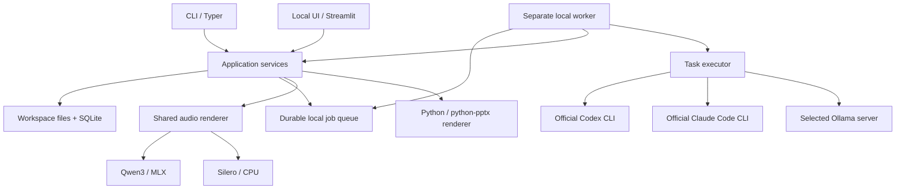

# Архитектура brofessor

Целевая архитектура, 01.11.2026. Фактический прогресс указан в плане реализации.

## Одно ядро, равноправные интерфейсы

Streamlit и CLI непосредственно вызывают Python application services. UI не запускает shell-команды CLI для бизнес-операций. Ядро не импортирует Streamlit/Typer и не зависит от провайдерских SDK. Отдельный HTTP API для связи собственных интерфейсов в v1 не нужен.

Разница интерфейсов - в представлении: UI показывает цитаты, JSON-редактор черновика, аудиоплеер и скачивание PPTX. CLI выдаёт читаемый текст или стабильный JSON, пути к тем же артефактам и статусы. PDF/PNG-превью используются отдельно для QA и пока не входят в UI.

## Предлагаемый стек

| Область | Выбор и основание |
|---|---|
| Core | Python 3.12, uv, Pydantic. Совместим с локальной обработкой документов и речи. Системный Python macOS не изменяется |
| CLI / UI | Typer / Streamlit как тонкие клиенты одной библиотеки |
| Состояние и поиск | SQLite и транзакции для состояния; BM25 по исходным фрагментам в Python для поиска. Отдельного сервера БД нет; `doctor` проверяет текстового исполнителя |
| Импорт | pypdf для текстового PDF, стандартные ZIP/XML для EPUB в порядке spine, обработчики Markdown/TXT |
| Текст | Официальные Codex/Claude CLI runners и прямой Ollama HTTP adapter |
| Речь | Qwen3-TTS CustomVoice через MLX, Silero CIS Base на CPU и F5 на Metal. Каталог задаёт движок, языки, голоса, настройки и источник весов. Общий аудиорендер отвечает за сегменты и монтаж; `speech.py` — за загрузку и синтез конкретных движков |
| Монтаж | FFmpeg/ffprobe, сегменты WAV и финальный MP3. Версии и параметры фиксируются |
| Презентации | `python-pptx>=1.0.2,<2` и Pillow внутри Python-сервиса. Измерение текста установленным шрифтом, native-объекты и заметки докладчика. Офисный пакет нужен только для отдельной визуальной QA, а не для генерации |
| Проверки | pytest, проверки типов/формата, Streamlit AppTest и браузерный smoke test. Настоящие модели отдельно от offline CI |

Это технические defaults, а не обязательная установка всех зависимостей для любой команды. Extras `ui` и `speech` позволяют запускать core CLI без интерфейса и моделей речи. Генератор PPTX входит в базовые Python-зависимости, отдельный runtime или framework ему не нужен. Runtime, встроенный в Codex desktop, не является зависимостью проекта.

## Исполнители

### Задания из UI или CLI

Worker выполняет фиксированный workflow и передаёт отдельные ограниченные задачи в `TaskExecutor`:

- `CodexRunner`: официальный `codex exec`, собственная сохранённая авторизация пользователя, вход через stdin/файл и структурированный финальный результат.
- `ClaudeCodeRunner`: официальный `claude -p`, собственная авторизация, JSON/schema output. Ограниченный запуск использует `--safe-mode --tools ""`, отключённые slash commands и MCP, без сохранения сессии. Настоящий подписочный сценарий проверен на Claude Code 2.1.185 в M4. Не использовать `--bare` для подписочного входа: этот режим не читает OAuth/Keychain.
- `OllamaExecutor`: генерация по `/api/chat` с JSON schema. Это вызов модели, а не передача ей управления shell.

Runner не импортирует книгу, не управляет очередью и не рендерит артефакты. Он решает конкретную смысловую задачу над предоставленным набором фрагментов. Необходимые данные выдаёт core. Для Claude отключены инструменты, для Codex выбран read-only sandbox с отключёнными shell/web и пользовательскими правилами. Реальные проверки стабильных CLI и точные ограничения записаны в [приёмке M4](experiments/v1-acceptance.md).

Процессы запускаются списком аргументов без shell-интерполяции. Им передаются deadline, лимит объёма и область доступа. Не используются публичные CI с подписочными credentials, собственный OAuth-посредник или извлечение токенов из файлов агента. При необходимости входа задача получает `needs_auth` с инструкцией штатного входа.

### Текст через Ollama

CLI или UI → worker → Ollama на выбранном IP:порту → TTS и файлы на компьютере приложения. По умолчанию адрес 127.0.0.1:11434, поэтому весь путь может работать локально. При выборе другого компьютера исходный текст обрабатывается на нём. Сервер должен сообщать отключённые облачные функции и установленную модель; cloud aliases и remote model metadata отвергаются до передачи источников. Redirects и HTTP proxies не используются. Проверенный локальный профиль остаётся доступен без подписки агента.

Адрес фиксируется в задании и участвует в checkpoint identity. Старые задания с `ollama_port` сохраняют loopback и прежние checkpoint keys; новые задания используют `ollama_address`.

## Контракты и ответственность

| Контракт | Содержимое и инвариант |
|---|---|
| `Source` / `SourceRevision` | ID, оригинальный файл, хеш, формат, происхождение, версия импортёра |
| `SourceUnit` / `Locator` | Страница PDF, глава/anchor EPUB или диапазон текста. Номера PDF и печатные номера различаются |
| `Coverage` | Обработанные, исключённые и проблемные единицы. Покрытие чтения и редакционный отбор хранятся отдельно |
| `EvidenceBundle` | Ограниченный набор оригинальных фрагментов с локаторами и revision, который получил исполнитель |
| `TaskRequest` / `TaskResult` | Тип операции, brief, evidence, JSON schema, настройки, provenance исполнителя, ошибки. Валидация до применения |
| `Answer` / `Draft` | Утверждения, ссылки, неопределённость, редакционные решения и пользовательские версии |
| `PodcastPlan` / `SlidePlan` | Структура результата, speaker IDs/языки, содержимое слайдов, ссылки на evidence. Не содержат команд shell |
| `SpeechBackend` | Текст сегмента, voice profile, язык и настройки → WAV, измеренная длительность и метаданные |
| `Artifact` | Формат, путь, хеш, входные версии, сценарий/план, инструмент рендеринга, результаты QA |
| `Job` / `Stage` | Состояние, checkpoint, ошибки, исполнитель, события, cancellation token и ссылки на результаты |

Валидная JSON schema и существующая цитата проверяют структуру. Достоверность и смысловое соответствие тезиса источнику проверяются отдельным шагом и на контрольном корпусе.

## Хранение и восстановление

Проект объединяет набор источников и связанные ответы, черновики, подкасты и презентации. В коде одному проекту соответствует один `workspace`. UI/CLI создают и выбирают именованные проекты, позволяют выбрать внешнюю папку и подключить существующий workspace. Новые проекты по умолчанию находятся в пользовательском каталоге данных вне приложения. Источники и результаты остаются внутри выбранного проекта; список проектов и последний выбор относятся к пользовательским настройкам приложения. Изменения настроек защищены коротким OS-lock и атомарной записью файла.

Одно workspace содержит оригиналы, извлечённые фрагменты, редактируемые Markdown/JSON drafts, аудиосегменты и результаты. SQLite является источником состояния для идентификаторов, revisions, заданий и событий. FTS-индекс производный и перестраивается. Для переносимости используются относительные пути и версия схемы. Корректно закрытый workspace можно скопировать целиком. Отдельного формата экспорта и импорта в v1 нет.

Схема 2 добавляет таблицу `notes`: append-only редакции с ID, данными `Note` (заголовок, текст, source IDs), необязательным origin `{job_id, revision}` и временем. Открытие схемы 0/1 добавляет таблицу и меняет `user_version`, сохраняя существующие записи; схема 2 уже не открывается старым приложением, знающим только 1. Нового хранилища или ORM нет. Заметки записываются синхронно в короткой SQLite-транзакции, без очереди и модели. `save_note` проверяет title/text и source IDs, а expected revision защищает от потери параллельных правок. Копирование ответа использует ID, производный от job/revision: повтор возвращает актуальную заметку, не заменяя авторскую редактуру. Origin сохраняется при редактировании; source IDs заметки не превращают её текст в первичное свидетельство. Оба интерфейса используют общие сервисы, а все редакции остаются в SQLite при переносе workspace.

Оригиналы и готовые версии артефактов неизменяемы. Новая редакция создаёт revision. Файл записывается во временный путь, проверяется и атомарно переносится до публикации ссылки в транзакции БД. Незарегистрированный файл после сбоя можно выявить без выдачи его как результата.

В v1 один worker на workspace и одна тяжёлая модельная операция одновременно. Получение задания атомарно. Один OS-lock удерживается весь срок жизни worker, второй процесс не начинает работу. Состояния: `queued`, `running`, `succeeded`, `failed`, `cancelled`, `interrupted`. Ошибка авторизации сохраняется как понятная причина неуспеха. Возобновление использует последний подтверждённый checkpoint, а не выдаёт незавершённый этап за успешный.

CLI и UI обращаются к общему локальному ProcessManager для запуска worker. После старта worker живёт независимо от родительского интерфейса. Он пишет прогресс в workspace. Streamlit периодически читает события, например через fragment. `session_state` хранит только выбранный экран, черновик формы и подобное временное состояние.

Идемпотентность защищает от повторного submit. Отмена останавливает принадлежащую заданию группу процессов, сохраняет завершённые сегменты и не трогает чужой сервер/процессы пользователя. При восстановлении PID сам по себе не считается доказательством живого worker. Получив OS-lock после аварии, новый worker переводит оставшиеся `running` задания в `interrupted`. Повторное выполнение запускается явно.

Для render общий сервис сначала фиксирует редакцию, модель, настройки и образцы голосов, затем получает автоматический ключ из тех же входов. CLI и UI не вычисляют его отдельно и повторно используют одно задание. Описательные поля каталога не меняют ключ. Явный `request_key` сохраняет первый принятый снимок, в том числе при одновременной отправке из двух клиентов; несовместимое назначение ключа отклоняется. Новая явная строка ключа позволяет создать отдельное задание с теми же входами.

Ключ переиспользования включает входные revisions, brief, prompts/schema version, выбранную модель/исполнителя, голос, язык, настройки и renderer/template version. Недоступную точную ревизию облачной модели отмечать как неизвестную, не обещать побитовую воспроизводимость.

## Работа с источниками и выводами

Обзор книги для медиа проходит по всем разделам с видимым покрытием. `ask` использует оригинальные фрагменты: до 24 тысяч символов сериализованных evidence — напрямую, для больших наборов — отбор в `questions.py`. Выбранный текстовый исполнитель пишет до четырёх RU/EN вариантов запроса. Существующий локальный BM25 ищет каждый вариант и сам вопрос; reciprocal-rank fusion с постоянной 60 объединяет результаты, оставляя восемь начальных совпадений. Для каждого совпадения сначала берутся оно само, два следующих и один предыдущий читаемый фрагмент того же источника, затем следующий результат. Контекст ограничен 90 тысячами символов вместе с IDs, именами и локаторами, без обрезки фрагментов. Это существующая верхняя граница итогового контекста чтения; больший объём выбран после реального пропуска продолжений сцен. Отдельной модели embeddings, индекса или сервиса нет.

`SearchQueries` и `Answer` проходят обычные checkpoint/cancellation/validation механизмы pipeline. Неподходящий для бюджета фрагмент не подменяется обрезанной выдержкой. Для `retrieved` карта содержит запросы, начальные совпадения и число выбранных фрагментов; остальные имеют `not_selected`, а не `read`. Выбранные фрагменты считаются прочитанными только после принятия ответа. UI и CLI явно показывают ограниченность поиска. При отсутствии совпадений возвращается `insufficient_evidence` без случайной подстановки источника и без дополнительного вызова модели ответа. Полнота отобранного контекста не гарантируется; текущих замеров достаточно, чтобы пока сохранить BM25.

`Answer` поддерживает `supported`, `insufficient_evidence`, `conflicting_evidence` и список `{citation, text}`. Все новые cited IDs должны иметь цитату из выбранного оригинала. `questions.validate_answer` разрешает лишь различия пробелов/переносов и восстанавливает исходную подстроку; изменения слов, чисел и пунктуации отклоняются до checkpoint и публикации. Для противоречия нужны минимум две разные цитаты, в том числе допускаются две позиции в одном фрагменте. Семантическое соответствие цитат выводу проверяется отдельно. Старые ответы без quotes сохраняют совместимость и явную отметку в UI. `service.answer_evidence` разрешает сохранённую редакцию в цитаты, имена файлов, локаторы и полные фрагменты для обоих интерфейсов; `draft show` добавляет это в envelope, оставляя `data` редактируемым контрактом. `service.search` задаёт общий scope/limit обычного локального поиска в CLI/UI, без модельных вызовов.

`service.follow_up` создаёт обычное `ask` job с унаследованными источниками, провайдером, настройкой модели, портом Ollama и языком (последний можно изменить). В params сохраняется плоский список `conversation` из закреплённых job/revision, а не ссылка на «последний ответ». Предыдущие ссылки берутся из уже сохранённого родителя; максимум шесть пар и 12 тысяч сериализованных символов. При превышении снимаются самые ранние пары с явным `conversation_omitted`; слишком большой единственный родитель вызывает ошибку без обрезки. Все старые jobs/drafts остаются в истории. `questions.history` проверяет ревизии и одинаковый source scope; `service.question_context` возвращает ровно тот контекст, который используют UI/CLI и pipeline.

Поисковое расширение видит контекст для разрешения местоимений. Итоговый prompt отдельно помечает прошлые ответы как редакционный контекст, который может быть ошибочным; ответы и их цитаты устанавливаются заново по оригиналам. Заметки автоматически в этот путь не включаются. Нового типа model job, агентного цикла или отдельного chat-хранилища нет. UI не разрешает сохранить ответ в заметку или уточнить его при несохранённых/устаревших правках; повторный submit одного текста для той же редакции идемпотентен. CLI явно отвергает provider/source flags у `--reply-to`, чтобы не игнорировать выбранные пользователем ограничения.

Текущее полное чтение реализовано в `reading.py`: короткий набор передаётся целиком, длинный — пакетами до 24 тысяч символов сериализованных фрагментов. Исполнитель возвращает ровно одну ограниченную заметку на каждый ID пакета; полнота и уникальность проверяются до checkpoint. Для итогового контекста до 90 тысяч символов слишком большие заметки дополнительно объединяются ограниченными группами с исходными ID. Текст не обрезается, но смысловая компрессия может терять детали. При отсутствии уменьшения задача завершается явной ошибкой, а не зацикливается.

`coverage.json` атомарно обновляется после принятого пакета. В нём остаются прочитанные, ожидающие и исключённые фрагменты с локаторами; короткие источники отмечаются прочитанными только после принятия итогового ответа. Общий `service.coverage` добавляет ссылки из сохранённой редакции, а для render — из закреплённой редакции. CLI `job coverage` и таблица Streamlit используют один отчёт. Старые отчёты с `read`/`excluded` разворачиваются по существующим исходным единицам без миграции БД.

Сценарий и слайды используют одну доказательную базу, но разные редакционные планы. Подкаст строится из устойчиво пронумерованных реплик. Роль ведущего, голос и язык разделены. Для серии сохраняются карта тем, термины и распределение материала между выпусками.

`models.Slides` — общий контракт исполнителей, редактора CLI/UI и рендера: у каждого слайда заголовок, до шести пунктов, notes и исходные IDs; дополнительно одна таблица (1–6 столбцов, 1–8 строк) либо 2–5 шагов. Рядом с таблицей/схемой допускаются до двух коротких пунктов. Старые drafts без необязательных полей проходят ту же валидацию. Prompt предлагает подходящий вид по содержимому и переносит пояснения в notes; отдельного LLM/layout framework нет.

`slides.render(plan, output, source_labels=...)` скрывает выбор native-компоновки и запись PPTX. Модуль не зависит от TTS, workspace, текстового провайдера или frontend. Существующий `media.render_slides` делегирует ему вызов; pipeline разрешает source IDs в имена файлов и оригинальные локаторы. Pillow измеряет обычный/жирный Arial, Liberation Sans или DejaVu Sans; выбранное семейство записывается в PPTX. Горизонтальная последовательность при длинных подписях становится вертикальной. Шрифты ограничены снизу: 28 pt заголовок, 20 pt пункты, 18 pt таблица/шаги. Межстрочный интервал задан явно. Если текст не помещается, возвращается ошибка с номером слайда; исходный план и предыдущий файл остаются целыми. Рендер не обрезает слова и не добавляет слайды за пользователя. Notes сохраняют исходный текст, все IDs и доступные подписи источников; на слайде остаётся короткий указатель. Запись атомарна. Шрифты не встроены: просмотр на машине с другим набором шрифтов требует проверки.

Сначала рендерится короткий фрагмент, затем выпуск. Продолжительность определяется готовым аудио. Поправки длины меняют сценарий содержательно. Техническая нормализация громкости и пауз не заменяет редактуру.

Для выпуска от 20 минут `podcasts.py` строит один outline с отдельными задачами частей и исходными ссылками; это план одного выпуска, не механизм серии. Затем пишет части примерно по пять минут с исходными ориентирами 125 слов/мин для RU и 100 для EN. Счётчик проверяет объём каждой части с допуском 15%; при нехватке/избытке текста или отсутствии одного ведущего допускается одна содержательная правка. Непринятая правка не попадает в checkpoint; продолжение повторяет только её. Готовые длинные реплики делятся по предложениям/словам до 300 символов RU или 400 EN с сохранением слов, ведущего и ссылок. Короткие previews сохраняют прежние prompts/checkpoints.

После озвучки общий расчёт возвращает фактическую длительность, отклонение от цели, число слов, наблюдаемый темп и ориентир для редактуры. Для полного выпуска требуется одновременно допуск 10% и диапазон 20–60 минут. CLI получает данные в metadata аудиоартефакта, UI показывает длительность и подсказку при расхождении. Переход к другой TTS не меняет этот контракт. Автоматического растягивания/обрезания аудио и цикла бесконечных модельных исправлений нет.

UI/CLI выбирают и скачивают поддерживаемые TTS-модели через общий сервис. Установленные веса хранятся в общем пользовательском кеше отдельно от приложения и проектов; задание сохраняет выбранную модель и её ревизию. Скачивание использует существующую очередь выбранного проекта и независимый worker; прогресс, отмена и продолжение доступны как для остальных заданий. Hugging Face Hub переиспользует завершённые файлы. Полные старые снимки импортируются в общий каталог через hardlink или копирование. Наличие всех файлов закреплённого размера проверяется до статуса «установлена»; генерация использует установленную модель без сетевого скачивания.

`download_model` сохраняет полный снимок выбранной модели до запуска worker: источник весов, ревизию и манифест файлов. Изменение каталога при продолжении не подменяет загрузку. Установленные спецификации сохраняются в общем пользовательском кеше и разрешаются по прежним ссылкам. Старые download jobs без снимка используют прежний формат; восстановить историческую ревизию только по ID невозможно. Аудиозадания также сохраняют снимок с голосами и настройками. Прежние Qwen jobs с `repo@revision` остаются читаемыми, включая установленную ревизию, удалённую из текущего каталога.

Silero скачивается с официального сервера в отдельный каталог общих файлов; версия закреплена SHA-256, размером и обязательной проверкой перед загрузкой модели. Прерывание сохраняет `.part`; HTTP Range продолжает загрузку, а сервер без Range начинает её заново. OS-lock на файл предотвращает одновременную запись из разных проектов. Это тот же тип задания и существующая очередь. Для Silero нужен отдельный extra `silero`, MLX не требуется.

Silero CIS Base подключена только для русского; ударения задаются знаком `+` в редактируемом черновике. Цифры, латинские названия и неподдержанные символы требуется записывать словами: иначе модель удаляет их при своей обработке текста. Сервис отвергает такой запрос до постановки аудиозадания, рендер повторно проверяет вход. В UI язык проверяется до включения кнопки озвучки. Qwen сохраняет поддержку RU/EN.

Worker явно отвергает неизвестные виды задания; неизвестный generation/render больше не попадает в ветку подкаста. Новому сценарию достаточно добавить собственные schema/обработчик и представления в CLI/UI. Универсального workflow engine нет.

F5-TTS v1 (английский), F5-TTS Russian v2 и ESpeech RL-V2 (русский) используют один адаптер `f5` и закреплённый общий Vocos. Каталог содержит config, checkpoint/vocab и манифест зависимости; выбор и скачивание остаются обычными заданиями. Общий кеш не дублирует Vocos. `speech_references.py` сохраняет PCM16 WAV и точную расшифровку по языку и роли; CLI и UI вызывают одну функцию. При submit образцы копируются в `voice-samples/` проекта, а относительные пути, SHA-256 и тексты фиксируются в model spec задания. Поэтому перенос закрытого проекта сохраняет входы озвучки. Ключ сегмента учитывает только образец конкретного ведущего и его расшифровку: изменение host не пересоздаёт guest.

F5 запускается на Metal через официальный стабильный пакет, Vocos читается только из установленного локального каталога. Передача точного текста образца исключает обращение к ASR; автоматический RUAccent не подключён. Инференс последовательно обрабатывает ограниченные фрагменты с проверкой отмены между ними. Отдельных UI/API/оркестраторов для нового движка нет. Зависимости F5 вынесены в extra `f5`; совместимый Hub 1.33 закреплён в lock вместо 2.4 из-за ограничения официальной зависимости `cached-path`. Совместимость скачивания и прежних workflow проверяется отдельно.

Серия реализована отдельным контрактом `series.Series` и обычным заданием `podcast_series`: карта тем, распределение ID тем по выпускам и общий словарь с исходными ссылками. Каждая тема должна относиться ровно к одному выпуску. Проверяются уникальность ID, заголовков и терминов, разрешимость ссылок и запрошенное число выпусков. Это структурная проверка карты, а не доказательство смысловой полноты или отсутствия перефразированных повторов.

`series_episode` создаёт обычное задание `podcast`, закрепляющее ID серии, редакцию её плана и номер выпуска. Исполнитель, модель, источники и длительность наследуются из серии. Номер редакции входит в ключ идемпотентности. Ручная правка плана сохраняется обычной версией draft и влияет только на новые запросы. Вся серия не запускается автоматически: пользователь проверяет план и запрашивает нужные выпуски из CLI или UI.

После принятия плана сохраняется ограниченный `series-evidence.json` с результатом `reading.prepare`. Эпизоды используют его и копию карты покрытия родителя с явной отметкой о переиспользовании. Пропажа заметок вызывает ошибку, а не незаметное перечитывание книги. Это файлы одного workspace без общего кеша между несвязанными заданиями и без нового состояния очереди. Контекст выпуска содержит назначенные темы, общий словарь и границы остальных выпусков. Рендер, сегментный кеш, отмена и восстановление остаются общими.

## Границы CLI и UI

Оба интерфейса вызывают общие application services для проектов, источников, генерации, редакций и управления заданиями. Правила валидации, фиксации входов и конфликтов редакций находятся в core. UI показывает только параметры выбранного результата; нерелевантные поля не меняют идентичность повторной отправки.

Текущие команды и примеры находятся в [README](../README.md#use-the-cli) и `brofessor --help`. Архитектура не дублирует справочник команд. Матрица проверок и фактические результаты находятся в [приёмке M4](experiments/v1-acceptance.md).

Новые аудиозадания принимают только модели из каталога или ранее сохранённые pinned specifications и фиксируют спецификацию при submit. Веса скачиваются явным download job; CLI может поставить render после уже ожидающего download. Старый resolver `repo@revision`/папки остаётся только на пути исполнения сохранённых jobs без спецификации. Публичного обхода каталога для новых заданий нет.

## UI первой версии

Четыре вкладки: источники, создание, задания и результаты, заметки. Пользователь выбирает проект и источники, видит проблемы импорта, задаёт вопросы и параметры подкаста/слайдов, редактирует drafts и наблюдает задания. Аудио доступно для прослушивания и скачивания, PPTX — для скачивания; превью изображений слайдов в UI нет. Настройки исполнителя находятся в sidebar.

Сервер слушает loopback по умолчанию. Это локальный single-user продукт, без облачного деплоя и встроенных аккаунтов. Загруженный файл сохраняется в управляемый путь workspace, имя от браузера не используется как доверенный путь. Размер/формат проверяются до обработки.

Язык интерфейса хранится отдельно от материалов в пользовательском `brofessor/preferences.json`: под `XDG_CONFIG_HOME`, на macOS — в `~/Library/Application Support`, иначе — в `~/.config`. Переключатель RU/EN сохраняет выбор атомарно; язык результата и данные workspace от него не зависят. При первом запуске без сохранённого выбора учитывается язык браузера. `session_state` хранит текущие поля и редактор; устойчивые ключи виджетов сохраняют их при переводе подписей.

Streamlit обслуживает локальный пользовательский сценарий. Отдельный API-сервер и будущие оболочки сейчас не проектируются.
