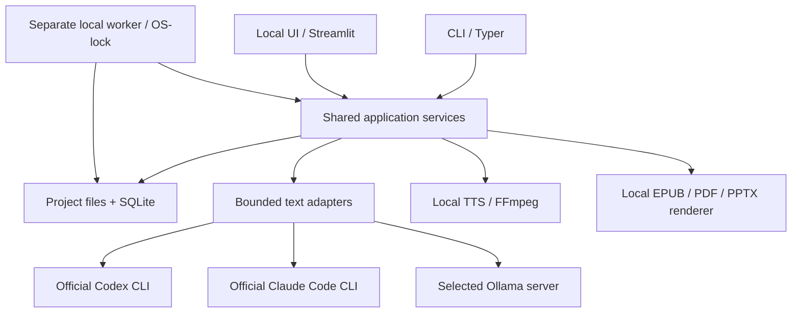

# brofessor specification

Updated 08.11.2026. This document contains current requirements, architectural constraints, and support boundaries. Rationale and revisions are in the [Decision log](decision-log.md), unfinished work is linked from the [Plan](plan.md), and installation and commands are in the [README](../README.md).

## Purpose and scenarios

brofessor is a local application for personal work with sources, following the NotebookLM model. Books are the main scenario, but sources and outputs are not limited to books. The name is always lowercase.

The user creates a project, adds sources or connects a directory, studies materials, and receives answers with citations. From the same originals, they prepare written reports, practice questions, podcasts and series, presentations, a book translation, or an audiobook. Results can be edited, versioned, and rebuilt, and remain accessible after restarting the application.

This is a local, single-user product. The primary setup uses existing subscriptions through official text CLIs or a selected Ollama server, with local speech synthesis and file rendering. Full parity with NotebookLM is not claimed.

## Functional requirements

R01-R23 retain the identifiers from the previous specification. R24 and R25 identify already accepted translation and directory requirements previously described in separate paragraphs. Features are implemented within the [support boundaries](#support-boundaries). An implementation does not establish verification on arbitrary materials and models.

| ID | Requirement | Verifiable outcome |
|---|---|---|
| R01 | Named projects with sources, notes, questions, and transformed outputs. Project selection in UI/CLI and storage in a chosen folder outside the application | The selected project's materials and results remain available after switching or restarting. Project data is isolated. Updating/moving the application preserves projects. An existing workspace can be opened as a project. A closed project can be transferred as a directory to another computer without the original agent |
| R02 | Import text-layer PDF, EPUB, Markdown, and TXT | Preserve the original, hash, version, structure, and locators. Recognize duplicates. Report unsupported/corrupt sources explicitly |
| R03 | Complete processing of large materials | Account for each extracted page/section as processed, excluded with a reason, or problematic. Empty extraction is not success |
| R04 | Search and questions over one or several selected sources | Answers contain verifiable references. Insufficient and conflicting evidence have explicit representations. Russian questions over English sources are supported |
| R05 | Control of focus and editing | Preserve audience, language, prompt, emphasis, and editorial exceptions. Manual edits create a new version and survive rebuilding |
| R06 | Podcasts and series, including automatic first narration | Target duration 20-60 minutes, at least two distinct voices, RU and EN. Requests for both languages produce separate versions by default. Series have a shared plan and consistent terminology |
| R07 | Presentations | Editable text, tables, and simple diagrams in PPTX, speaker notes, and source references. Illustrations may be raster images. A full-slide image does not replace an editable slide |
| R08 | CLI and Streamlit UI parity | Both interfaces perform the same operations and see the same data. A job can be created in one, then observed, cancelled, and resumed in the other |
| R09 | Agent and model independence | Shared contracts work with Codex CLI, Claude Code CLI, and Ollama. Switching runners requires no reimport |
| R10 | Resume and cancellation | Closing the UI does not stop the worker. Completed stages and audio segments survive a crash. Cancellation terminates the job's child processes and prevents new stages |
| R11 | Explicit costs and data transfer | No automatic paid fallback. The local profile sends no material to cloud models. A Codex subscription is not treated as a universal API key |
| R12 | Reproducible and portable installation | Installation does not depend on libraries secretly bundled with a particular desktop agent. Record tool/model versions and licenses for verified configurations |
| R13 | Ready-to-use local Qwen3-TTS Base narration in UI and CLI | UI downloads start only in Settings. The project selects a model and links to Settings when files are missing. Requirements, size, file availability, and current progress remain visible after closing/reopening Settings and restarting the UI. Interrupted downloads resume as the same pinned-version job without duplicates. A new podcast's first narration follows script saving in the worker. Missing model/runtime or audio failure preserves the finished text. Cancellation of continuation persists. After edits, narrate an explicitly selected saved revision. The card shows progress, a player, and the audio/text revision match. Weights are shared across projects. History records each render's exact model, voices, and revision |
| R14 | Task navigation | “All projects” is the main sidebar button, with search and settings icons beside brofessor. Create tasks inside a project. “Tasks” opens the full catalogue without a duplicate card link. A task name is separate from its request and material title, survives generation, and can be renamed. Global project/task search and the catalogue match title/request word prefixes on every keystroke, including matching empty projects. A folder name opens the project, while its separate arrow expands tasks. Rows are neutral, with type/date and only significant statuses. Project folders are above shared recent tasks. Multiple folders expand without a rerun, and a divider adjusts list heights. The project path appears on its page. A podcast with renders, a series with episodes, and a discussion each occupy one row. Explicit UI/CLI opening updates ordering, while search and progress polling do not |
| R15 | Shared settings dialog | UI language is separate from content language. Include default models, download management, and storage. Save is atomic. Cancel/close discards unsaved preferences. Works without a project |
| R16 | Task models | Copy defaults on creation. A task carries its own settings with the project. Changes affect future runs, while resume retains the original snapshot. Regeneration retains history within the same task |
| R17 | Safe maintenance | Downloads use the existing worker/SQLite outside the project catalogue. Attempt history with dates/outcomes is clearly separate from current model availability. Deleting managed weights, partial downloads, and segment caches preserves sources, revisions, and finished files. Busy resources are protected across projects |
| R18 | Written reports: comparison, guide, reference, and argument analysis | One editable CLI/UI result with versions and Markdown. Source statements and brofessor adaptations are distinguishable, with exact quotes in every cited section. References preserve formulas/units and reuse accepted terminology from a pinned translation revision. Analysis distinguishes claims, evidence, assumptions, and limitations. Missing support does not imply falsehood |
| R19 | Understanding checks | Scenario and open questions based on originals, saved answers, and explanations with citations. A review pins question/answer revisions, sources, and model. Later edits do not change past reviews. No numerical grading |
| R20 | Audiobook | Sequential narration of the full extracted original or a pinned saved translation. Chapters, MP3/M4B, existing local TTS, revision retention, cancellation/resume, and reuse of unchanged segments. Footnotes and tables follow extraction order. Raster text is not narrated. Narration-text edits are explicitly marked |
| R21 | Reversible project/task deletion | With confirmation, UI and CLI hide an entire project or task with related runs and allow restoration. Preserve sources, revisions, files, and unfinished edits. Active work must be cancelled first. Removing an item from the application does not clear the disk |
| R22 | Durable execution progress | Shared CLI/UI show completed, current, and upcoming stages, conditional branches, and stage-local counter units. Active, queue, and paused time are distinct and survive restart. Resume indicates reused results. Old timing is not reconstructed. First narration is part of the podcast workflow. Rendering after edits starts explicitly |
| R23 | Readable and editable prompts | All authored instructions are in a separate package with a catalogue, variables, schemas, and local preview without inference. A new job pins texts and hashes. Edits apply to new runs, while retry/resume retains its original instructions and accepted checkpoints |
| R24 | Book translation preserving formatting and professional terminology | Supported EPUB and text-layer PDF use the shared worker, CLI/UI, sense glossary, exact occurrences, and revisions. Preserve resources, structure, and originals. Term correction retains manual exceptions. Rebuild locally from a chosen saved revision without inference |
| R25 | Document directories and Obsidian as sources | Connecting stores the path without preliminary traversal or model calls. A task searches, reads originals, and follows allowed links. Read versions remain available after the directory changes or is disconnected. A new task sees current materials. Full reading checks every extractable unit in the requested scope |

## Material and result rules

- A source is a saved original with a version and locators. A summary, earlier answer, or user note does not replace primary evidence. Import and connected directories support text-layer PDF, EPUB, Markdown, and TXT.
- Search without generation runs locally. Answers distinguish support, insufficient evidence, and conflict. Every new reference has a verbatim quote from the selected original. Whitespace and line-wrap differences are normalized, while changes to words, numbers, and punctuation are rejected. Semantic support for conclusions is checked separately.
- Full reading accounts for every extractable unit in the requested scope. Relevance selection shows its limited coverage. A search hit is not read until its original is read and the result accepted. Errors, empty extraction, and exceeded budgets do not become successful full reading.
- A follow-up pins the parent revision and inherits sources and models. The earlier answer provides editorial context, while facts are established again from originals. Personal notes retain versions and an optional link to the original answer.
- The action determines parameters. A new task copies shared models, and its settings affect future runs. Resume preserves the original run's inputs. New series episodes and follow-ups inherit the appropriate parent context. Output language is selected on creation and is independent of UI language.
- An ordinary podcast includes automatic first narration after script saving. Audio failure preserves the text. After user edits, narration starts explicitly for a saved revision. Individual-turn preview is optional. A series first receives an editable plan and glossary, then the user requests the desired episodes.
- The regular podcast writer remains the default. Revisiting originals section by section with working memory is an explicit experimental mode. A separate script check pins the revision and model, shows partial coverage and insufficient context, does not rewrite text, and does not automatically block narration.
- A written report uses a comparison, guide, reference, or argument-analysis template. Source positions and brofessor adaptations are distinguishable. Each saved revision receives Markdown without a new model call. A reference can use the accepted glossary of a pinned translation. There is no separate mutable report glossary.
- Translation distinguishes a term's sense, chosen equivalent, and original occurrences. Correcting a sense changes only linked phrases. Manual exceptions are retained and shown. Regeneration preserves history and the accepted glossary. When discussing a word's meaning, retain its original spelling alongside the translation.
- An audiobook narrates the full extracted original or pinned translation sequentially without text generation. EPUB follows the spine, PDF follows extracted page order, and Markdown follows headings. Footnotes and tables follow extracted order. Edited narration is marked. Earlier versions and unchanged segments are preserved.

## Quality and acceptance

- Locators resolve to specific saved originals. Valid JSON, an existing ID, and an exact quote do not establish factual correctness. The control corpus includes unanswerable questions, conflict, multiple documents, cross-language questions, and details from the middle of long material.
- Measure podcast duration from finished audio. Technical checks require both deviation of at most 10% from the request and the 20-60-minute range. This diagnoses results rather than guaranteeing every generation's duration. Add substantive material when short. Automatic stretching, truncation, and empty repetition are unacceptable.
- Both voices must remain distinct and stable. Check omissions, cutoffs, silence, and pronunciation of names, numbers, and terms. ASR and technical measurements do not replace listening. Do not promise hour-long episode speed or subjective quality without corresponding measurements.
- Check presentations in an editor and after rendering: text, tables, and simple diagrams must actually be editable. Overflow fails explicitly with the slide number, preserving the original plan and previous file. Text is not truncated. Fonts are not embedded, so viewing on another machine needs checking.
- Large UI sections have distinct headings, boundaries, and independent collapse controls. Separate the finished file, material, domain sources/checks, and service settings. Errors, unsaved changes, and save actions remain accessible when material is closed. History does not switch the current editor or file.
- One scenario matrix checks CLI and UI, duplicate submission, concurrent edits, cancellation, failure, and resume. Accepted stages do not repeat inference. Separately check the installed package outside the checkout and the worker's independent lifetime.
- Verify real tools and models separately from offline contracts. Results apply to the stated version, material, and scenario. Mark unverified combinations explicitly. Development checks do not become mandatory manual work for every user.

## Architecture

### Components and responsibilities

CLI and Streamlit call the same Python services directly. Business rules, validation, and revision pinning belong to the core. The UI does not perform business operations through CLI shell commands. Domain contracts are independent of frontend and provider SDKs. There is no separate API server, external queue, worker leases, or universal workflow engine.

Stack: Python 3.12, uv, Typer, Pydantic, SQLite, Streamlit, Pydantic AI Slim for navigation and Ollama transport, and `python-pptx>=1.0.2,<2` with Pillow for presentations. EPUB uses local ZIP/XML processing. PDF uses pypdf/PDFium, ReportLab, and Pyphen. Speech uses separate extras and pinned models, with FFmpeg for assembly. Exact dependencies are in [pyproject.toml](../pyproject.toml) and [uv.lock](../uv.lock). The desktop agent runtime is not a product dependency.

### Package structure

| Directory | Responsibility |
|---|---|
| `interfaces/cli/`, `interfaces/web/` | Commands, pages, dialogs, components, and presentation JS |
| `application/` | Shared operations, pipeline, worker, projects, tasks, progress, and model maintenance |
| `features/` | Sources and navigation, books, podcasts, questions, reports, and learning |
| `infrastructure/` | SQLite and preferences, text runners, agent adapter, speech, import, and format rendering |
| `contracts/`, `models.py` | Shared named values and records, and Pydantic result contracts |
| `prompts/` | Editable instructions, catalogue, loader, preview, and earlier-template archive |

Format-specific contracts stay with their owner. Shared definitions do not import application, storage, UI, or SDK modules. Closed choices use explicit persisted strings. Annotations do not replace runtime validation. Backward compatibility with earlier internal schemas, workflows, browser keys, and profiles is unsupported. Current snapshots, operation keys, and user revisions are checked as current-product behavior. Code-change rules are in [AGENTS.md](../AGENTS.md), and the instruction map is in the [prompt catalogue](../src/brofessor/prompts/README.md).

### State and recovery

One project corresponds to one workspace: originals, extracted fragments, revisions, audio segments, finished files, and SQLite. State is in SQLite, while the derived search index can be rebuilt. Project-local paths are relative. A closed project transfers as a directory, without a separate archive format. The project registry, shared preferences, and weight cache live outside the application and individual projects.

Each workspace runs one worker holding an OS-lock for its full lifetime, with one heavy operation at a time. Job acquisition is atomic. Closing the UI or creator process does not stop the worker. After a crash, a new worker marks remaining runs interrupted. The user explicitly requests resume. A status row without a live OS-lock does not prove a process is running. The guardian bounds the external runner's and its descendants' lifetimes.

A job pins sources, brief, revision, model/connection, prompts, workflow versions, and render parameters. A repeated request key retains the first accepted inputs and rejects incompatible use. The automatic render key is shared by CLI/UI. Segment caching depends on the text and speaker-specific voice inputs. The exact cloud-model revision may be unknown. Bit-for-bit reproducibility is not promised.

Revisions and originals are immutable. Saving creates a new version with an expected-revision check. Files are checked at temporary paths and published atomically. Unfinished edits have recovery copies. The active field also recovers from browser storage at its previous address. Leave the input field first to transfer its latest characters. Unsaved buffers are not render inputs.

Text jobs store template texts and hashes in `prompt_snapshot`. New work and regeneration receive current instructions. Retry/resume of the current workflow retains its own. Checkpoints account for complete runner messages. Jobs without snapshots, earlier workflow versions, and old EPUB/PDF projections are not executed. Create a new task for them. Sources, saved revisions, and finished files are not deleted.

First narration, its cancellation/resume, and measured stages persist with the job. Active, queue, and paused time are distinct. After a crash, only recorded intervals count. Downtime is not computation. Timings are not invented for older jobs.

### Reading and model calls

Imported sources are read in full as a small set or in bounded batches with explicit coverage. Questions over large sets use local BM25 with query variants and neighboring fragments. Compression can lose detail. Originals remain available. There is no separate embedding model or external search service.

Connecting a directory stores only its path, without preliminary indexing, summaries, or inference. During a task, a Pydantic Agent performs bounded list/search/read/links operations through the existing bounded runners. Application operations, budgets, snapshots, and full-coverage checks remain in brofessor. Document code, Obsidian plugins, and Dataview are not executed. Paths and links stay inside the root. Hidden/system directories and symlinks are excluded.

Current navigation limits: 100 000 supported documents, 32 MiB search text, 24 model steps, 6 actions per step, 48 000 context characters, and 80 000 selected-original characters. Exceeding a limit fails explicitly with progress preserved. The application checks full coverage. Relevant selection does not promise completeness.

Codex and Claude use official CLIs with the user's own authorization and bounded tasks, without shell interpolation. Codex uses JSONL transport with a separate final result. Claude uses a bounded run without tools or extensions. Ollama uses `OllamaModel` through Pydantic AI Direct API and native schema. Automatic retries, proxies, redirects, and telemetry are disabled. Deadlines, cancellation, limits, preflight, citations, and publication remain application responsibilities.

### Data transfer and maintenance

Import, model inference, and artifact publication have separate network boundaries. Codex/Claude process supplied text at their providers. Ollama receives text at the explicitly selected IP:port, defaulting to `127.0.0.1:11434`. The server must confirm disabled cloud features and an installed model. TTS, assembly, and file rendering run locally. There is no automatic cloud or paid-API fallback.

Authorization uses the user's official tools. brofessor does not read or transmit subscription tokens. A Desktop session does not replace terminal CLI login. Sources are untrusted data and do not authorize tools, commands, uploads, or permission changes.

The UI starts model downloads only in shared Settings. CLI commands are explicit. Maintenance uses a separate workspace of the same local worker. Downloads pin a revision and manifest, are independent of the dialog and selected project, reuse completed files, and resume partial files when supported by the server. Attempt history is separate from current file availability. Busy resources are protected across projects. Cache cleanup preserves originals, revisions, recovery, and finished results.

## Support boundaries

| Area | Supported and verified | Limitation |
|---|---|---|
| Text runners | Real short Codex, Claude, and Ollama scenarios. See [acceptance](evidence/2026-11-02-provider-acceptance.md), [Claude](evidence/2026-11-06-claude-authentication.md), and [Ollama](evidence/2026-11-07-ollama-transport.md) | Compatibility depends on the specific model, context, runtime, and license. Other models and large materials are not accepted automatically |
| Podcasts | Two RU/EN voices, 20-60-minute targets, regular `qwen3-base` with ready-made ExNihilus voices. The user approved the Russian five-minute sample. See [long checks](evidence/2026-11-03-qwen-long-dialogues.md) and [series](evidence/2026-11-02-podcast-series.md) | The English pair and arbitrary long episodes have not passed full user listening acceptance. Personal acceptance was removed from the plan. Manual stress marks are unreliable in Qwen Base. Earlier profiles and adapters were removed. Current narration uses only Qwen Base |
| Presentations | Editable PPTX text, tables or simple sequences, notes, and references. See [visual checks](evidence/2026-11-02-pptx.md) | No Google Slides export or UI PDF/PNG preview. An illustration may be raster, a whole slide may not |
| EPUB | Unencrypted reflowable EPUB 2/NCX and EPUB 3/XHTML, protected markup, resources, metadata, code/math, and notices. See [whole book](evidence/2026-11-04-epub-recurring-terms.md) | Reject fixed layout, scripts, media overlays, and arbitrary DTD/entities. One short book does not establish quality for arbitrary textbooks. Complete term/anchor coverage and publisher-level proofreading are not guaranteed |
| PDF translation | Supported horizontal text, locally retained graphics, images, and links. See [31-page book](evidence/2026-11-05-pdf-translation.md) | No OCR, arbitrary inline mathematics, or complex geometry. Reject encryption/forms, rotation/crop, Type0, shared/transformed Forms, and undecodable regions. Translation overflow fails explicitly |
| Directories and Obsidian | Task-time reading, original versions and locators, internal links, and explicit full coverage. See [navigation checks](evidence/2026-11-05-source-navigation.md) | The personal vault and large directories were not part of acceptance. Only supported formats work. Code and plugins do not run |
| Reports, learning, audiobook | Checked short text examples and two-chapter local narration. See [checks](evidence/2026-11-06-learning-and-audiobook.md) | This is not acceptance of a full audiobook, arbitrary models, or a statistical assessment of learning quality |

Text inside raster images is neither translated nor narrated. Input files are limited to 100 MiB. Original text must be extractable. Scans are not considered read. Visual preservation does not mean identical publisher typesetting.

The verified full hardware setup is an Apple Silicon Mac M4 with 32 GiB memory. Supported Qwen Base narration requires Apple Silicon. Other memory configurations and complete operation on other operating systems are unverified. Qwen code and weights use Apache-2.0, ready-made ExNihilus samples use CC0. Dependency and material licenses are considered separately. Use stable versions and pinned revisions. Alpha-only experiments must be isolated and explicitly labeled.

Current SQLite schema 6 is supported. Schemas 0-5 are not migrated: opening such a database fails explicitly without rewriting data. Current-format changes do not require earlier-format support. Originals, manual edits, and finished results are retained independently of the ability to resume old computation. User materials, generated files, caches, weights, and credentials are excluded from the public repository. Historical report artifacts may exist only in local ignored `outputs/` or temporary directories.

Public hosting, built-in accounts, collaborative editing, universal plugins, and a separate host-agent protocol are outside current scope. Google Slides and additional source formats remain outside it and do not themselves create plan tasks.
