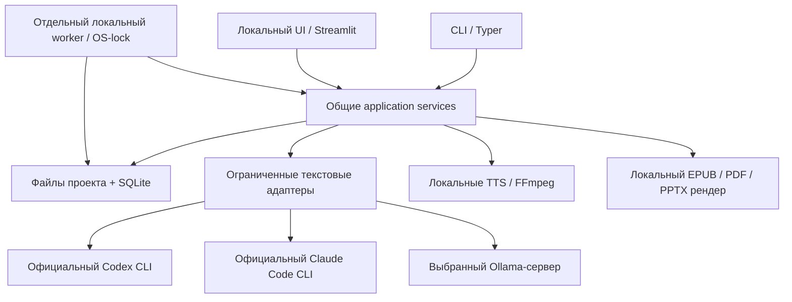

# Спецификация brofessor

Актуализировано 08.11.2026. Здесь находятся действующие требования, архитектурные ограничения и границы поддержки. Причины выбора и пересмотры — в [Decision log](decision-log.md), незавершённые работы — в [Plan](plan.md). Установка и команды — в [README](../README.md).

## Назначение и сценарии

brofessor — локальное приложение для личной работы с источниками по модели NotebookLM. Книги — основной сценарий, но источники и результаты не ограничены книгами. Название всегда пишется со строчной буквы.

Пользователь создаёт проект, добавляет источники или подключает каталог, изучает материалы и получает ответы с цитатами. Из тех же оригиналов он готовит письменные отчёты, учебные вопросы, подкасты и серии, презентации, перевод книги или аудиокнигу. Результаты можно редактировать, сохранять версиями и пересобирать, возвращаясь к ним после перезапуска приложения.

Это локальный продукт для одного пользователя. Основной профиль — существующие подписки официальных текстовых CLI либо выбранный Ollama-сервер, локальная озвучка и рендер файлов. Полный паритет с NotebookLM не заявляется.

## Функциональные требования

R01–R23 сохраняют идентификаторы прежней спецификации. R24 и R25 выделяют уже принятые требования к переводу и каталогам, прежде описанные отдельными абзацами. Возможности реализованы в пределах раздела [«Границы поддержки»](#границы-поддержки); наличие реализации не означает проверку на любых материалах и моделях.

| ID | Требование | Проверяемый результат |
|---|---|---|
| R01 | Именованные проекты с источниками, заметками, вопросами и результатами переработки. Выбор проектов в UI/CLI и хранение в выбранной папке отдельно от приложения | После переключения или перезапуска доступны материалы и результаты выбранного проекта. Данные разных проектов изолированы. Обновление/перемещение приложения сохраняет проекты; существующий workspace можно открыть как проект. Закрытый проект можно перенести каталогом на другой компьютер без исходного агента |
| R02 | Импорт PDF с текстовым слоем, EPUB, Markdown и TXT | Сохраняются оригинал, хеш, версия, структура и локаторы. Дубликаты распознаются. Неподдерживаемые/повреждённые источники получают явный статус |
| R03 | Полнота обработки больших материалов | Каждая извлечённая страница/раздел учтена как обработанная, исключённая с причиной или проблемная. Пустое извлечение не считается успехом |
| R04 | Поиск и вопросы по одному или нескольким выбранным источникам | Ответ содержит проверяемые ссылки. Для недостатка данных и противоречий есть явное представление. Поддержан вопрос на русском к английскому источнику |
| R05 | Управление фокусом и редактурой | Сохраняются аудитория, язык, промпт, акценты и редакционные исключения. Ручные правки создают новую версию и не теряются при пересборке |
| R06 | Подкасты и серии, включая первую автоматическую озвучку | Целевая длительность 20–60 минут, минимум два различимых голоса, RU и EN. Для запроса обоих языков по умолчанию отдельные версии. Серии имеют общий план и согласованные термины |
| R07 | Презентации | Редактируемые текст, таблицы и простые схемы в PPTX, заметки докладчика и ссылки на источники. Иллюстрации могут быть растровыми. Полноэкранная картинка не заменяет редактируемый слайд |
| R08 | Равноправие CLI и Streamlit UI | Оба интерфейса выполняют одни операции и видят одни данные. Задание можно создать в одном, наблюдать, отменить и продолжить в другом |
| R09 | Независимость от агента и модели | Общие контракты работают с Codex CLI, Claude Code CLI и Ollama. Смена исполнителя не требует повторного импорта |
| R10 | Продолжение и отмена работы | Закрытие UI не прекращает worker. После аварии сохраняются законченные этапы и аудиосегменты. Отмена прекращает дочерние процессы задания и запуск новых этапов |
| R11 | Явные расходы и передача данных | Нет автоматического платного fallback. Локальный профиль не отправляет материал в облачные модели. Подписка Codex не считается универсальным API-ключом |
| R12 | Воспроизводимость и переносимость установки | Установка не зависит от библиотек, тайно поставляемых конкретным desktop-агентом. Версии инструментов, моделей и лицензий фиксируются для проверенных конфигураций |
| R13 | Готовая локальная озвучка Qwen3-TTS Base в UI и CLI | В UI запуск скачивания — только в настройках; проект выбирает модель и предлагает переход при отсутствии файлов. Видны требования, размер, наличие файлов и актуальный прогресс после закрытия/открытия настроек и перезапуска UI. Прерванная загрузка продолжается тем же заданием с сохранённой версией, без дублей. Первая озвучка нового подкаста следует за сохранением сценария в worker. Отсутствие модели/runtime или сбой звука сохраняют готовый текст. Отмена продолжения устойчива; после правок озвучивается явно выбранная сохранённая редакция. Карточка показывает ход, плеер и соответствие аудио тексту. Веса общие для проектов. История хранит точную модель, голоса и редакцию каждого рендера |
| R14 | Навигация по задачам | «Все проекты» — главная кнопка общей панели; поиск и настройки — значки рядом с brofessor. Создание задачи — внутри проекта. «Задачи» открывает полный каталог без дублирующего перехода в карточке. Название задачи отделено от запроса и заголовка материала, сохраняется при генерации и поддерживает переименование. Общий поиск проектов и задач и каталог используют префиксы слов названия/запроса на каждый символ; находится и совпадающий пустой проект. Название папки открывает проект, отдельная стрелка раскрывает задачи; строки нейтральные, с типом/датой и только существенными статусами. Папки проектов сверху, общие недавние задачи снизу; несколько папок раскрываются без rerun, высота списков регулируется разделителем. Путь проекта — на его странице. Подкаст с рендерами, серия с выпусками и обсуждение имеют одну строку. Явное открытие из UI/CLI обновляет порядок; поиск и опрос прогресса — нет |
| R15 | Общее окно настроек | Язык UI отдельно от языка содержимого, модели по умолчанию, управление загрузками и хранилищем. Save атомарен; Cancel/закрытие отменяют несохранённые предпочтения. Работает без проекта |
| R16 | Модели задачи | Дефолты копируются при создании; задача переносит собственные настройки вместе с проектом. Изменение влияет на будущие запуски, а resume сохраняет исходный snapshot. Перегенерация оставляет историю в той же задаче |
| R17 | Безопасное обслуживание | Загрузки живут в существующем worker/SQLite вне каталога проектов. История попыток с датами и исходами явно отделена от текущего наличия моделей. Удаление управляемых весов, частей загрузок и кеша сегментов сохраняет источники, редакции и готовые файлы; занятые ресурсы защищены между проектами |
| R18 | Письменные отчёты: сопоставление, руководство, справочник и разбор аргументации | Один редактируемый результат в CLI/UI с версиями и Markdown. Источник и адаптация brofessor различимы, каждый раздел со ссылками имеет точные цитаты. Справочник сохраняет формулы/единицы и переиспользует принятую терминологию закреплённой редакции перевода. Разбор отделяет утверждения, свидетельства, допущения и границы; отсутствие подтверждения не означает ложность |
| R19 | Проверка понимания | Ситуационные и открытые вопросы по оригиналам, сохранённые ответы и объяснения с цитатами. Разбор закрепляет редакцию вопросов/ответов, источники и модель; последующая правка не меняет прошлую проверку. Числовых оценок нет |
| R20 | Аудиокнига | Последовательное озвучивание полного извлечённого оригинала или закреплённого сохранённого перевода. Главы, MP3/M4B, существующий локальный TTS, сохранение редакций, отмена/продолжение и переиспользование неизменённых сегментов. Сноски и таблицы следуют порядку извлечения, текст растра не озвучивается; правка дикторского текста явно отмечена |
| R21 | Обратимое удаление проекта и задачи | UI и CLI с подтверждением скрывают весь проект или задачу со связанными запусками и позволяют восстановить. Источники, редакции, файлы и незавершённые правки сохраняются; активную работу требуется сначала отменить. Удаление из приложения не очищает диск |
| R22 | Сохраняемый ход выполнения | Общие CLI/UI показывают пройденные, текущий и предстоящие этапы, условные ветви и единицы локального счётчика. Активное время, очередь и остановки различимы, сохраняются при перезапуске; resume обозначает переиспользование результатов. Старое время не реконструируется. Первая озвучка входит в процесс подкаста, после правки рендер запускается явно |
| R23 | Доступные для чтения и редактуры промпты | Все авторские инструкции вынесены в отдельный пакет с оглавлением, переменными, схемами и локальным предпросмотром без inference. Новое задание закрепляет текст и хеши; правка применяется к новому запуску, а повтор/resume сохраняет прежние инструкции и принятые checkpoints |
| R24 | Перевод книг с сохранением оформления и профессиональной терминологии | EPUB и текстовый PDF поддержанного класса используют общий worker, CLI/UI, словарь значений, точные употребления и версии. Ресурсы, структура и оригинал сохраняются; коррекция термина удерживает ручные исключения. Перевод можно локально пересобрать из выбранной редакции без inference |
| R25 | Каталог документов и Obsidian как источник | Подключение сохраняет путь без предварительного обхода и модельных вызовов. Задача ищет, читает оригиналы и следует разрешённым ссылкам. Прочитанные версии доступны после изменения или отключения каталога; новая задача видит текущие материалы. Полное чтение проверяет все извлекаемые единицы запрошенной области |

## Правила работы с материалами и результатами

- Источник — сохранённый оригинал с версией и локаторами. Конспект, прежний ответ и пользовательская заметка не заменяют первичное свидетельство. Импорт и подключённый каталог поддерживают PDF с текстовым слоем, EPUB, Markdown и TXT.
- Поиск без генерации работает локально. Ответ различает подтверждение, недостаток данных и противоречие. Каждая новая ссылка сопровождается дословной цитатой из выбранного оригинала; различия пробелов и переносов нормализуются, изменения слов, чисел и пунктуации отклоняются. Смысловая поддержка вывода проверяется отдельно.
- Полное чтение учитывает все извлекаемые единицы запрошенной области. Релевантный отбор показывает свой ограниченный охват. Найденный поиском фрагмент не считается прочитанным до чтения оригинала и принятия результата. Ошибка, пустое извлечение и превышение бюджета не превращаются в успешное полное чтение.
- Уточнение ответа закрепляет редакцию родителя и наследует источники и модели; прошлый ответ служит редакционным контекстом, факты заново устанавливаются по оригиналам. Собственные заметки сохраняют версии и необязательную ссылку на исходный ответ.
- Параметры определяются действием. Новая задача копирует общие модели; её настройки влияют на будущие запуски. Resume сохраняет входы исходного запуска. Новый выпуск серии и уточнение наследуют подходящий контекст родителя. Язык результата выбирается при создании и независим от языка UI.
- Обычный подкаст включает первую автоматическую озвучку после сохранения сценария. Ошибка звука сохраняет текст. После пользовательской правки озвучка запускается явно для сохранённой редакции; проба отдельной реплики необязательна. Серия сначала получает редактируемый план и словарь, затем пользователь запрашивает нужные выпуски.
- Обычный автор подкаста остаётся дефолтным. Возвращение к оригиналам по частям со служебной памятью — явный экспериментальный режим. Отдельная проверка сценария закрепляет редакцию и модель, показывает частичный охват и недостаточный контекст; она не переписывает текст и не блокирует озвучку автоматически.
- Письменный отчёт использует шаблон сравнения, руководства, справочника или разбора аргументации. Позиция источника и адаптация brofessor различимы. Каждая сохранённая редакция получает Markdown без нового модельного вызова. Справочник может использовать принятый словарь закреплённого перевода; отдельного изменяемого словаря отчёта нет.
- Перевод отделяет значение термина, выбранный эквивалент и исходные употребления. Исправление значения меняет только привязанные фразы; ручные исключения удерживаются и показываются пользователю. Перегенерация сохраняет историю и принятый словарь. При обсуждении значения самого слова исходное написание сохраняется рядом с переводом.
- Аудиокнига последовательно озвучивает полный извлечённый оригинал или закреплённый перевод без текстовой генерации. EPUB следует spine, PDF — порядку извлечения страниц, Markdown — заголовкам. Сноски и таблицы следуют извлечённому порядку. Изменённый дикторский текст отмечается; прежние версии и неизменённые сегменты сохраняются.

## Качество и приёмка

- Локаторы разрешаются в конкретные сохранённые оригиналы. Валидный JSON, существующий ID и точная цитата не доказывают фактическую верность вывода. Контрольный корпус включает отсутствие ответа, конфликт, несколько документов, межъязыковой вопрос и сведения из середины длинного материала.
- Длительность подкаста измеряется по готовому аудио. Технический контроль использует одновременно отклонение не более 10% от запроса и диапазон 20–60 минут. Это критерий диагностики результата, а не гарантия длительности любой генерации. Недостающий объём исправляется содержательно; автоматическое растягивание, обрезка и пустые повторы недопустимы.
- Два голоса должны оставаться различимыми и стабильными. Проверяются пропуски, обрывы, тишина, произношение имён, чисел и терминов. ASR и технические измерения не заменяют прослушивание. Скорость часового выпуска и субъективное качество не обещаются без соответствующего измерения.
- Презентация проверяется в редакторе и после рендера: текст, таблицы и простые схемы действительно редактируются. Переполнение вызывает явный отказ с номером слайда, сохраняя исходный план и предыдущий файл. Текст не обрезается. Шрифты не встраиваются, просмотр на другой машине требует проверки.
- Крупные разделы UI имеют различимые заголовки, границы и независимое сворачивание. Готовый файл, материал, предметные источники/проверки и служебные настройки разделены. Ошибки, несохранённые изменения и действия сохранения доступны при закрытом материале. История не переключает текущий редактор или файл.
- Одна матрица сценариев проверяет CLI и UI, повторную отправку, конкурентную правку, отмену, сбой и продолжение. Уже принятый этап не вызывает повторный inference. Отдельно проверяются установленный пакет вне checkout и независимая жизнь worker.
- Реальные инструменты и модели проверяются отдельно от offline-контрактов. Результат проверки относится к указанным версии, материалу и сценарию; непроверенные комбинации обозначаются явно. Проверки при разработке не становятся обязательной ручной работой каждого пользователя.

## Архитектура

### Компоненты и ответственность

CLI и Streamlit напрямую вызывают одни Python-сервисы. Бизнес-правила, валидация и фиксация редакций находятся в ядре. UI не выполняет бизнес-операции через shell-команды CLI. Предметные контракты не зависят от frontend или провайдерского SDK. Отдельного API-сервера, внешней очереди, worker leases и универсального workflow engine нет.

Стек: Python 3.12, uv, Typer, Pydantic, SQLite, Streamlit; Pydantic AI Slim для навигации и транспорта Ollama; `python-pptx>=1.0.2,<2` и Pillow для презентаций. EPUB обрабатывается локально через ZIP/XML; PDF — через pypdf/PDFium, ReportLab и Pyphen. Речь использует отдельные extras и закреплённые модели; монтаж — FFmpeg. Точные зависимости находятся в [pyproject.toml](../pyproject.toml) и [uv.lock](../uv.lock). Runtime desktop-агента не является зависимостью продукта.

### Структура пакета

| Каталог | Ответственность |
|---|---|
| `interfaces/cli/`, `interfaces/web/` | Команды, страницы, диалоги, компоненты и JS представления |
| `application/` | Общие операции, pipeline, worker, проекты, задачи, ход выполнения и обслуживание моделей |
| `features/` | Источники и навигация, книги, подкасты, вопросы, отчёты и обучение |
| `infrastructure/` | SQLite и настройки, текстовые runners, адаптер агента, речь, импорт и рендер форматов |
| `contracts/`, `models.py` | Общие именованные значения и записи; Pydantic-контракты результатов |
| `prompts/` | Редактируемые инструкции, каталог, загрузчик, предпросмотр и архив прежних шаблонов |

Контракты конкретного формата остаются у владельца. Общие определения не импортируют application, хранилище, UI или SDK. Закрытые значения используют явные сохраняемые строки; аннотации не заменяют runtime-валидацию. Обратная совместимость с прежними внутренними схемами, workflow, browser keys и профилями не поддерживается. Текущие snapshots, ключи операций и пользовательские редакции проверяются как поведение действующего продукта. Правила изменения кода находятся в [AGENTS.md](../AGENTS.md), карта инструкций — в [оглавлении промптов](../src/brofessor/prompts/README.md).

### Состояние и восстановление

Один проект соответствует одному workspace: оригиналы, извлечённые фрагменты, редакции, аудиосегменты, готовые файлы и SQLite. Состояние находится в SQLite, производный поисковый индекс можно перестроить. Пути внутри проекта относительные. Закрытый проект переносится каталогом; отдельного архивного формата нет. Реестр проектов, общие предпочтения и кеш весов находятся вне приложения и отдельных проектов.

В workspace работает один worker с OS-lock на весь срок жизни и одной тяжёлой операцией одновременно. Получение задания атомарно. Закрытие UI или процесса-создателя не прекращает worker. После аварии новый worker помечает оставшиеся запуски прерванными; продолжение явно запрашивается пользователем. Одна строка состояния без живого OS-lock не доказывает работу процесса. Guardian ограничивает жизнь внешнего runner и его потомков.

Задание закрепляет источники, brief, редакцию, модель/подключение, промпты, версии workflow и параметры рендера. Повторный request key удерживает первые принятые входы, несовместимое назначение отклоняется. Автоматический ключ рендера общий для CLI/UI. Кеш сегментов зависит от текста и голосовых входов конкретного говорящего. Точная ревизия облачной модели может быть неизвестна; побитовая воспроизводимость не обещается.

Редакции и оригиналы неизменяемы. Сохранение создаёт новую версию с проверкой ожидаемой редакции. Файлы проверяются во временном пути и публикуются атомарно. Незавершённые правки имеют recovery-копию; активное поле дополнительно восстанавливается из браузерного хранилища по прежнему адресу. Для переноса самых последних символов нужно сначала покинуть поле ввода. Несохранённый буфер не служит входом рендера.

Текстовые задания хранят тексты шаблонов и хеши в `prompt_snapshot`. Новая работа и регенерация получают действующие инструкции, retry/resume текущего workflow сохраняют свои. Checkpoint учитывает полные сообщения runner. Задания без snapshot, прежние версии workflow и проекции EPUB/PDF не исполняются; для них создаётся новая задача. Источники, сохранённые редакции и готовые файлы не удаляются.

Первая озвучка, её отмена/продолжение и измеренные этапы сохраняются вместе с заданием. Активное время, очередь и остановки различаются. После аварии учитываются записанные интервалы, время простоя не превращается в вычислительную работу. Старым заданиям измерения не придумываются.

### Чтение и модельные вызовы

Импортированные источники читаются коротким набором целиком либо ограниченными пакетами с явным покрытием. Для вопросов по большим наборам используется локальный BM25 с вариантами запроса и соседними фрагментами. Сжатие может терять детали; оригиналы остаются доступны. Отдельной embedding-модели и внешнего поискового сервиса нет.

Подключение каталога сохраняет только путь, без предварительной индексации, конспектов и inference. Во время задачи Pydantic Agent выполняет ограниченные list/search/read/links через прежние bounded runners. Прикладные операции, бюджеты, snapshots и проверка полного охвата остаются в brofessor. Код документов, плагины Obsidian и Dataview не исполняются; пути и ссылки ограничены корнем, скрытые/системные каталоги и symlinks исключаются.

Текущие пределы навигации: 100 000 поддержанных документов, 32 MiB текста поиска, 24 модельных шага, 6 действий за шаг, 48 000 символов контекста и 80 000 символов выбранных оригиналов. Превышение даёт явный отказ с сохранением прогресса. Полный охват проверяет приложение, релевантный отбор не обещает полноты.

Codex и Claude запускаются официальными CLI с собственной авторизацией пользователя и ограниченной задачей, без shell-интерполяции. Codex использует JSONL transport и отдельный финальный результат; Claude — ограниченный запуск без инструментов и расширений. Ollama использует `OllamaModel` через Direct API Pydantic AI и native schema; автоматические retries, proxies, redirects и телеметрия отключены. Deadline, отмена, лимиты, preflight, цитаты и публикация остаются ответственностью приложения.

### Передача данных и обслуживание

Импорт, модельный inference и публикация артефактов имеют отдельные сетевые границы. Codex/Claude обрабатывают переданный текст у своего провайдера. Ollama получает текст на явно выбранном IP:порту; по умолчанию — `127.0.0.1:11434`. Сервер должен подтвердить отключённые cloud-функции и установленную модель. TTS, монтаж и рендер файлов выполняются локально. Автоматического перехода на облако или платный API нет.

Авторизация выполняется официальными средствами пользователя. brofessor не читает и не передаёт subscription tokens; Desktop-сессия не заменяет вход в терминальный CLI. Источники считаются недоверенными данными и не дают разрешения на инструменты, команды, uploads или изменение прав.

UI запускает загрузки моделей только в общих настройках; CLI использует явные команды. Обслуживание работает в отдельном workspace того же локального worker. Загрузка закрепляет ревизию и манифест, не зависит от диалога или выбранного проекта, переиспользует законченные файлы и продолжает части при поддержке сервера. История попыток отделена от текущего наличия файлов. Занятые ресурсы защищены между проектами; очистка кеша сохраняет оригиналы, редакции, recovery и готовые результаты.

## Границы поддержки

| Область | Поддержано и подтверждено | Ограничение |
|---|---|---|
| Текстовые исполнители | Настоящие короткие сценарии Codex, Claude и Ollama; [приёмка](evidence/2026-11-02-provider-acceptance.md), [Claude](evidence/2026-11-06-claude-authentication.md), [Ollama](evidence/2026-11-07-ollama-transport.md) | Совместимость определяется конкретной моделью, контекстом, runtime и лицензией. Другие модели и большие материалы не принимаются автоматически |
| Подкасты | Два голоса RU/EN, целевые 20–60 минут; обычный профиль `qwen3-base` с готовыми ExNihilus. Русский пятиминутный образец одобрен пользователем; [длинные проверки](evidence/2026-11-03-qwen-long-dialogues.md) и [серия](evidence/2026-11-02-podcast-series.md) | Английская пара и произвольные длинные выпуски не прошли полную пользовательскую слуховую приёмку. Личная приёмка снята с плана. Ручные ударения Qwen Base ненадёжны. Прежние профили и их адаптеры удалены; текущая озвучка использует только Qwen Base |
| Презентации | Редактируемый PPTX: текст, таблица или простая последовательность, notes и ссылки; [визуальные проверки](evidence/2026-11-02-pptx.md) | Google Slides export и PDF/PNG-превью в UI отсутствуют. Иллюстрация может быть растровой, весь слайд — нет |
| EPUB | Незашифрованный reflowable EPUB 2/NCX и EPUB 3/XHTML; защищённая разметка, ресурсы, метаданные, код/математика и notices; [целая книга](evidence/2026-11-04-epub-recurring-terms.md) | Fixed layout, скрипты, media overlays и произвольные DTD/entities отвергаются. Одна небольшая книга не доказывает качество любых учебников; полнота терминов/anchors и издательская корректура не гарантированы |
| PDF-перевод | Горизонтальный текст поддержанного класса, локальное сохранение графики, картинок и ссылок; [31-страничная книга](evidence/2026-11-05-pdf-translation.md) | OCR, произвольная inline-математика и сложная геометрия не поддержаны. Encryption/forms, rotation/crop, Type0, shared/transformed Forms и недекодируемые области отклоняются. Переполнение перевода вызывает явный отказ |
| Каталоги и Obsidian | Чтение по задаче, оригинальные версии и локаторы, внутренние ссылки, явный полный охват; [контроль навигации](evidence/2026-11-05-source-navigation.md) | Личный vault и крупные каталоги не участвовали в приёмке. Работают только поддержанные форматы, код и плагины не запускаются |
| Отчёты, обучение, аудиокнига | Сверенные короткие текстовые примеры и двухглавая локальная озвучка; [проверки](evidence/2026-11-06-learning-and-audiobook.md) | Это не приёмка целой аудиокниги, произвольной модели или статистическая оценка качества обучения |

Надписи внутри растра не переводятся и не озвучиваются. Размер входного файла ограничен 100 MiB. Оригинальный текст должен извлекаться; сканы не считаются прочитанными. Визуальная сохранность не равна тождественной издательской вёрстке.

Проверенный полный аппаратный профиль — Apple Silicon Mac M4 с 32 GiB памяти. Поддерживаемая озвучка Qwen Base требует Apple Silicon; достаточность памяти других конфигураций и работа на других ОС целиком не подтверждены. Код и веса Qwen имеют Apache-2.0, готовые образцы ExNihilus — CC0; лицензии зависимостей и материалов учитываются отдельно. Используются стабильные версии и закреплённые ревизии; alpha-only опыт должен быть изолирован и явно обозначен.

Поддерживается текущая SQLite schema 6. Схемы 0–5 не мигрируются: открытие такой базы завершается явной ошибкой, данные не переписываются. Изменения текущего формата не требуют поддержки прежнего; исходники, ручные правки и готовые результаты сохраняются отдельно от возможности продолжить старое вычисление. Пользовательские материалы, сгенерированные файлы, caches, weights и credentials не входят в публичный репозиторий. Исторические артефакты из отчётов могут находиться только в локальном ignored `outputs/` или временных каталогах.

Публичный хостинг, встроенные аккаунты, совместное редактирование, универсальные плагины и отдельный host-agent protocol не входят в текущий объём. Google Slides и дополнительные форматы источников остаются за его границами и сами по себе не создают задач в плане.
